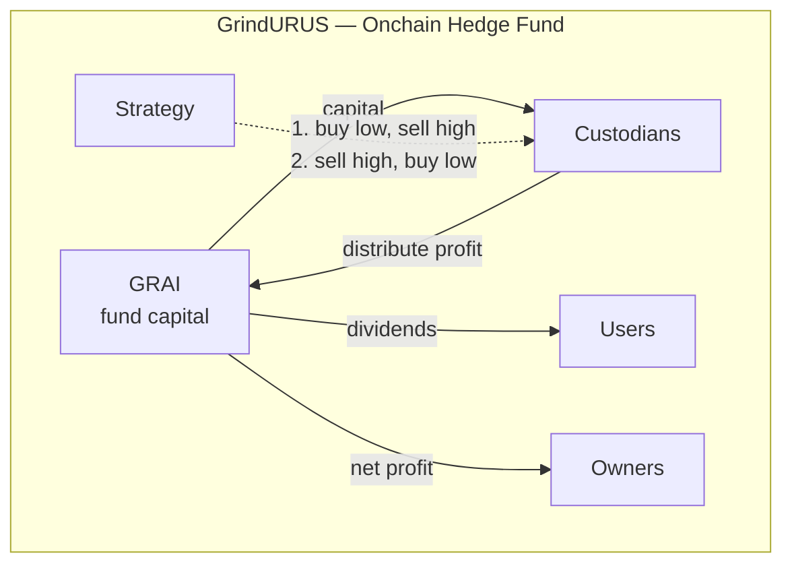
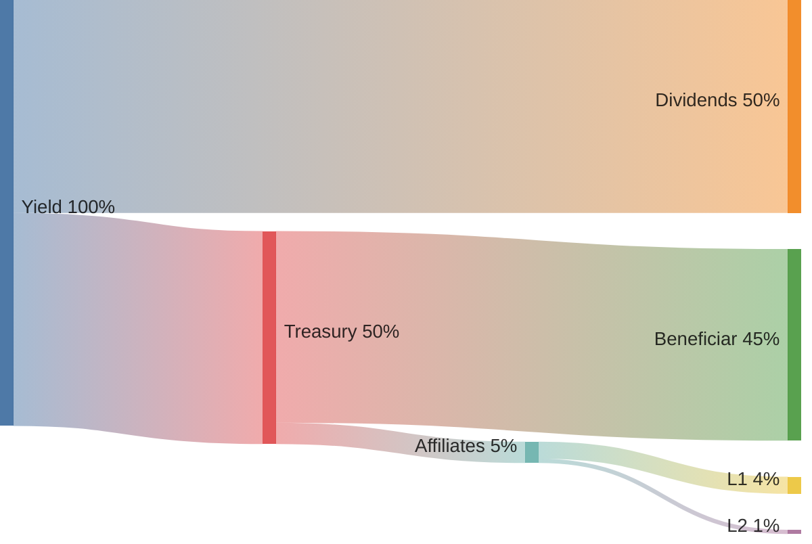

# Overview

How GrindURUS delivers what the [Manifesto](manifesto.md) claims. For contract-level detail see [Protocol overview](../protocol/overview.md), [GRAI](../protocol/grai/overview.md), [Grinders](../protocol/grinders/overview.md), [Strategy](../protocol/grinders/strategy.md).

---

## Opportunity → product

| Manifesto | How we satisfy it |
| --------- | ----------------- |
| Realized volatility moves every second; majors ±0–8%/day, alts often more | GrindURUS runs **DIRECT** (grow quote) and **INVERSE** (grow base) on the same pair — harvest both edges of the swing, not a direction bet |
| Most on-chain yield is a side effect of lending, LP, or solvency | Yield here is **reported trading profit**: custodians trade allocated capital; toreador **`distribute`**s into GRAI → dividends + treasury |

Deposit listed assets → mint **GRAI** (USD book-priced share). Capital sits in **Grinders** reserve / custodian NFTs while off-chain Grinders trade real terminals. Holders stay passive: lock → claim when profit is on-chain.



---

## Beliefs → protocol

### 1. Mathematics

**Claim:** Structural alpha from positional math (`ψ(t) → A·P + Q + a·p + q`), not colocation or heavy compute per tick.

**Delivery:** Off-chain **URUS / GrindURUS** is the algebra and strategy loop. On-chain does **not** re-run the model — it stores shares, locks, votes, and payouts. Same math drives every adapter; venues only execute.

→ [Strategy](../protocol/grinders/strategy.md)

### 2. DeFi & tokenized assets

**Claim:** 24/7 open rules — book-priced shares, reported profit, governed fund, automated taking while holders stay passive.

**Delivery:**

| Piece | Role |
| ----- | ---- |
| **GRAI** | Book-priced ERC20 / program share; deposit, lock, claim, liquidation redeem |
| **Grinders (on-chain)** | Reserve + custodian NFTs; allocate / deallocate / distribute; heartbeat |
| **Treasury** | Protocol fee sink + affiliate tree on claim |
| **Governance limbs** | Vote quorum on GRAI **and** stale Grinders heartbeat to open liquidation |

Holders do not operate desks. Profit enters tokenomics only when **`distribute`**d — custodian trades do not rewrite `totalValue`.

→ [GRAI overview](../protocol/grai/overview.md) · [Grinders overview](../protocol/grinders/overview.md)

### 3. Intents & composable terminals

**Claim:** One layer, both sides of the market, wherever liquidity is — CEX, AMM, or intent network.

**Delivery:** Strategy layer adapters (Binance/CCXT, CoW, Jupiter, LiFi, …) under Grinder processes — grind, swap/route, and store in DeFi where wired. On-chain **custodian kinds** (path, swap, cow, lifi, aave_v3, …) hold that inventory. Same math; different rails.

→ [Strategy](../protocol/grinders/strategy.md) · [Grinders — Trade](../protocol/grinders/overview.md#4-trade)

---

## We are not → enforced by design

| We are not | Why the stack refuses that shape |
| ---------- | -------------------------------- |
| CEX/DEX or copy-trading feed | No order book or signal product — fund shares + custody + reported yield |
| Prediction market / direction bet | Both DIRECT and INVERSE on the same pair; edge is structure, not a side |
| Live-redeem stablecoin-style vault | While **GRINDING**, no protocol redeem. Exit: sell GRAI, unlock, bribe, or liquidation (quorum + `!grinding`) → redeem |

---

## We are → two modules

**Algorithmic quantitative on-chain hedge fund** that grinds realized volatility through rules.

| Module | Where | Job |
| ------ | ----- | --- |
| **GRAI** | On-chain | Store capital as shares; distribute money (dividends, treasury, redeem) |
| **Grinders** | Off-chain + thin on-chain custody | Decide and trade; reserve + custodian wallets |

In short: **GRAI holds and pays out; Grinders decides and trades.**

```
depositors ──► GRAI ──► Grinders reserve ──► custodian NFTs ──► off-chain Grinder
                 │              │                                      │
                 │              └── allocate / deallocate               │
                 ◄────────────── distribute(yield) ◄───────────────────┘
                 ├── dividends → lockers (claim)
                 └── treasury → affiliates + beneficiar
```

Map: [protocol.svg](../protocol/protocol.svg) · [protocol.png](../protocol/protocol.png)

---

## Who this is for → paths

| Audience            | Path                                                                                                    |
| ------------------- | ------------------------------------------------------------------------------------------------------- |
| **Investors**       | App: deposit → GRAI → lock → claim when yield is distributed                                            |
| **Private clients** | Same machinery on their pair / treasury (dedicated custodian + Grinder)                                 |
| **Agents**          | Wallet holds GRAI; protocol grind + claim — no desk, no model per tick on-chain                         |
| **Builders**        | [Mechanics](../protocol/grai/mechanics.md) · [repositories](../developers/repositories.md) after audits |

### Typical investor path

1. Deposit a listed asset into **GRAI** → mint at book.
2. Optionally **lock** (unvoted) to earn dividends.
3. Custodians trade; toreador **`distribute`**s profit on-chain.
4. **Claim** asset dividends — or exit via market / unlock / liquidation redeem.

### Yield at a glance (defaults)

When profit is distributed: **~50%** dividends to unvoted lockers, **~50%** treasury. On claim, treasury inventory pays affiliates (~5% of yield L1/L2) and the rest to **beneficiar**.



---

## Read next

| Want | Go |
| ---- | -- |
| Beliefs and positioning | [Manifesto](manifesto.md) |
| Module map | [Protocol overview](../protocol/overview.md) |
| Share token & payouts | [GRAI overview](../protocol/grai/overview.md) |
| Custody & heartbeat | [Grinders overview](../protocol/grinders/overview.md) |
| Strategy & adapters | [Strategy](../protocol/grinders/strategy.md) |
