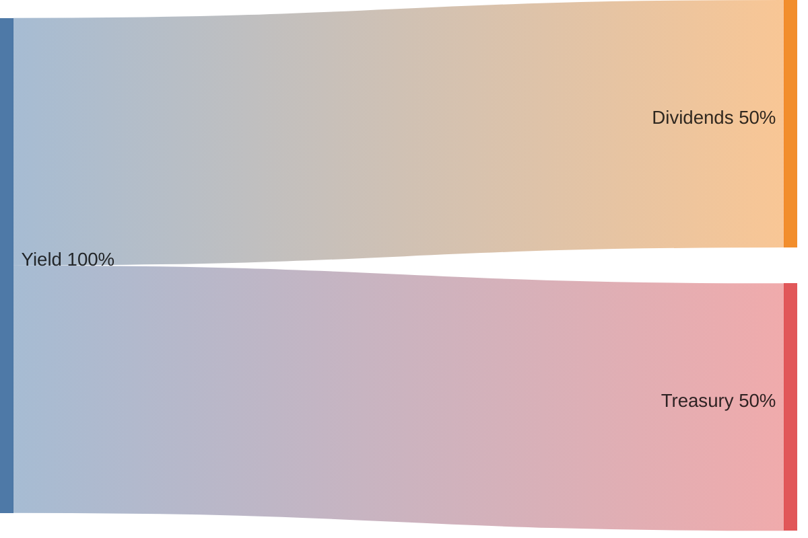
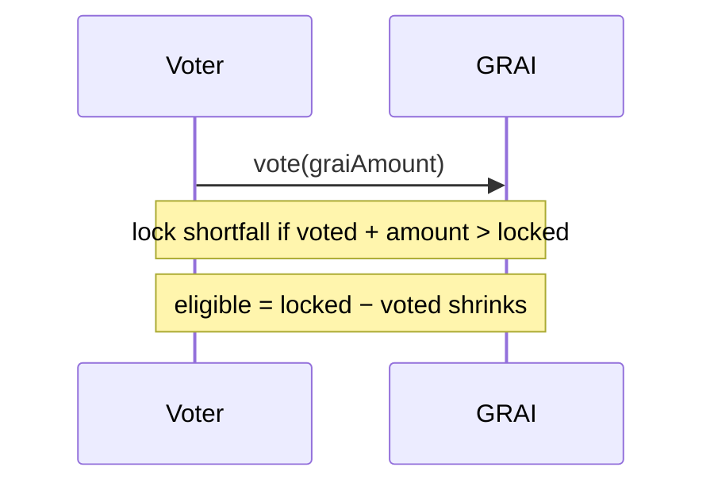
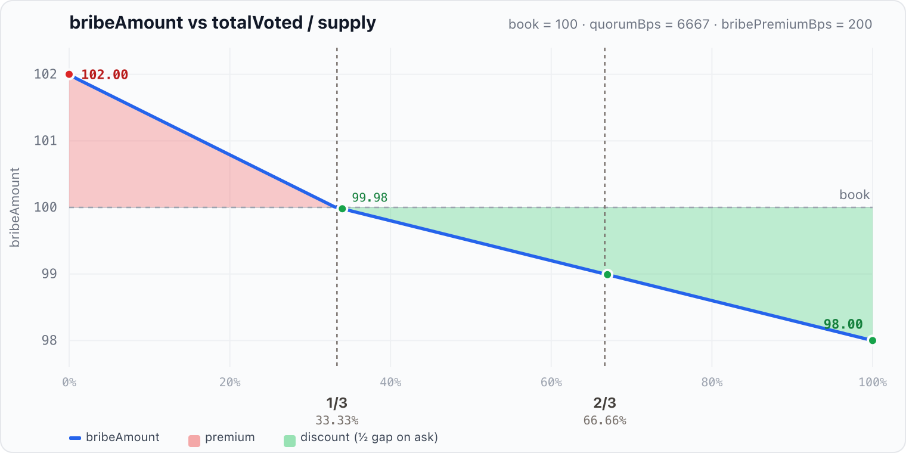
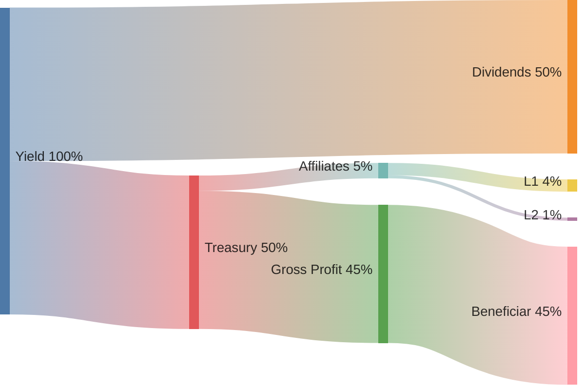

# GRAI mechanics

Expanded write-up of [GRAI overview](overview.md). Same section order and topics; here: diagrams, formulas, worked examples, and the **EVM entrypoints** each mechanic maps to.

The key words **MUST**, **MUST NOT**, **REQUIRED**, **SHALL**, **SHALL NOT**, **SHOULD**, **SHOULD NOT**, **RECOMMENDED**, **NOT RECOMMENDED**, **MAY**, and **OPTIONAL** are as in [RFC 2119](https://www.rfc-editor.org/rfc/rfc2119) / [RFC 8174](https://www.rfc-editor.org/rfc/rfc8174).

Derived from [GRAI.sol](https://github.com/grindurus/grindurus-evm/blob/main/src/GRAI.sol), [IGRAI.sol](https://github.com/grindurus/grindurus-evm/blob/main/src/interfaces/IGRAI.sol), [Treasury.sol](https://github.com/grindurus/grindurus-evm/blob/main/src/Treasury.sol), [Grinders.sol](https://github.com/grindurus/grindurus-evm/blob/main/src/Grinders.sol) (EVM, October 2026). Tests: [GRAILifecycle.t.sol](https://github.com/grindurus/grindurus-evm/blob/main/test/GRAILifecycle.t.sol), [GRAIMintPremium.t.sol](https://github.com/grindurus/grindurus-evm/blob/main/test/GRAIMintPremium.t.sol), [GRAIRoles.t.sol](https://github.com/grindurus/grindurus-evm/blob/main/test/GRAIRoles.t.sol), [TreasuryReferrals.t.sol](https://github.com/grindurus/grindurus-evm/blob/main/test/TreasuryReferrals.t.sol), [TreasuryPoach.t.sol](https://github.com/grindurus/grindurus-evm/blob/main/test/TreasuryPoach.t.sol).

Map: [protocol.svg](../protocol.svg) · [protocol.png](../protocol.png). Config tables, Grinders, access, invariants, and full ABI tables live in [§A–§F](#a-oracle-and-configuration).

---

## 0. Economic shape

Short form: [overview §0](overview.md#0-economic-shape). Here the same framing is unpacked against protocol state.

Economically, GRAI is an **indexed perpetual delivery put option** with a **dynamically recalculated strike price**, **earning** a **premium** for bearing **volatility risk** through **listed assets**. 

Capital sits in **Grinders**; GRAI is the share ledger and cashflow harness (mint, lock, vote, dividends, liquidation redeem). §§1–9 below are that harness.

```
holder  →  lock()  →  locker (unvoted)  →  vote()  →  voter  ←  bribe()  ←  briber
                      earn dividends           no dividends on voted
                      (locked − voted)         quorum / bribe market
```

### Formal model

The formal model below is how we write that phrase in protocol state:

> *indexed perpetual delivery put option with a dynamically recalculated strike price, earning a premium for bearing volatility risk through listed assets.*

Two layers, two notations. **Contracts** never store a strike; \(K_t\) lives only in the Grinders trading book. Caveats follow the formulas.

#### On-chain ledger (contracts)

USD scale = 6 decimals unless noted; asset amounts in native decimals.

| Symbol | Meaning |
| ------ | ------- |
| \(q(t)\) | quote inventory |
| \(b_i(t)\) | balance of listed asset \(i\) (\(i > 0\)) |
| \(p_i(t)\) | price of asset \(i\) |
| \(V(t)\) | valuation of the index |
| \(S(t)\) | `totalSupply` — GRAI shares |
| \(c_i(t)\) | `totalClaimable` reserved for dividends in \(i\) |
| \(r_i(t)=b_i(t)-c_i(t)\) | redeemable balance of \(i\) |
| \(L_t,\; W_t\) | `totalLocked`, `totalVoted` |
| \(A_t\) | dividend index `accShare` (1e18) |
| \(R\) | \(R \in \{\texttt{GRINDING},\,\texttt{REDEMPTION}\}\) |

**Indexed.** The index is the set of inventories

\[
\mathcal{I}(t)
\;=\;
\bigl\{\, q(t) \,\bigr\}
\;\cup\;
\bigl\{\, b_i(t) \;\big|\; i > 0 \,\bigr\}
\]

with valuation

\[
V(t)
\;=\;
q(t) + \sum_{i > 0} b_i(t)\,p_i(t)
\]

(Share mint / `graiOut` is §1, not part of the index definition.)

**Perpetual.** No expiry \(T\). Regime \(R \in \{\texttt{GRINDING},\,\texttt{REDEMPTION}\}\). Exercise is regime-gated:

\[
\text{exercise allowed}
\;\iff\;
R=\texttt{REDEMPTION}
\;\wedge\;
t \ge t_{\mathrm{liq}} + \texttt{liquidationPeriod}
\]

While \(R=\texttt{GRINDING}\), redeem is unavailable (exit = sell / unlock / bribe).

**Delivery put.** Basket delivery on-chain — no cash settlement, **no strike in the payoff**:

\[
\Pi_{\mathrm{put}}(x)
\;=\;
\Bigl\{\, x\cdot\tfrac{r_i(t)}{S(t)} \;\text{ of asset } i \;\Big|\; i\in\mathrm{listed} \,\Bigr\}
\]

Oracle mark of that delivery (per share of the basket, separate valuation):

\[
N_t^{\mathrm{redeem}}
\;=\;
\frac{1}{S(t)}\sum_{i\in\mathrm{listed}} p_i(t)\,r_i(t)
\]

USD mark of burning \(x\) GRAI is \(x\cdot N_t^{\mathrm{redeem}}\). ([§9](#9-liquidation-open--redeem--revive).)

**Premium.** Yield for bearing volatility of \(\{p_i\}\). On push of amount \(Y\) of asset \(i\):

\[
Y_{\mathrm{div}} = \Bigl\lfloor Y\cdot\frac{\texttt{dividendCutBps}}{\mathrm{BPS}}\Bigr\rfloor
,\qquad
Y_{\mathrm{treas}} = Y - Y_{\mathrm{div}}
\]

\[
\texttt{eligible} = L_t - W_t
,\qquad
A_t \mathrel{+}= \frac{Y_{\mathrm{div}}\cdot 10^{18}}{\texttt{eligible}}
\quad(\texttt{eligible}=0 \Rightarrow Y_{\mathrm{div}}\to\text{Treasury})
\]

Locker claim on \(i\) integrates index growth against unvoted lock. ([§3](#3-distribute), [§4](#4-claim).)

#### Grinders book (off-chain, per trading pair)

Per pair the same shape as a one-asset slice of \(\mathcal{I}\): quote \(q(t)\), base \(b(t)\), venue spot \(p(t)\). Spot mark of the pair:

\[
v(t) = q(t) + b(t)\cdot p(t)
\]

Target NAV of the pair (quote units) — a **different** valuation from index \(V(t)\) and from redeem mark \(N_t^{\mathrm{redeem}}\):

\[
N^{\star} = q(t) + b(t)\cdot K_t
\]

When attainable on base (\(N^{\star} > q(t)\) and \(b(t) > 0\)):

\[
K_t = \frac{N^{\star} - q(t)}{b(t)}
\]

Otherwise \(K_t\) is **undefined** — no free-standing strike object. \(K_t\) is **not** in any contract storage or ABI; it only steers pair allocation when defined. ([§C](#c-grinders-layer).)

**Dynamics.** The system is dynamic: continuous marks (e.g. \(p_i\)) plus protocol **impulses**

\[
\Delta q,\; \Delta b_i,\; \Delta S,\; \Delta c_i,\; \Delta A
\]

(deposit / unlock / distribute / claim / redeem / fund, …). \(R\) switches by jump. Not a closed ODE \(\dot x=f(x)\).

| Valuation | Symbol | Layer | What it is |
| --------- | ------ | ----- | ---------- |
| Index mark | \(V(t)\) | economic | \(q+\sum_i b_i p_i\) |
| Redeem mark | \(N_t^{\mathrm{redeem}}\) | contracts | oracle NAV of \(\{r_i\}/S(t)\) |
| Pair spot mark | \(v(t)\) | Grinders | \(q+b\,p\) at venue spot |
| Pair target | \(N^{\star}\) | Grinders | target NAV (≠ \(V(t)\)) |
| Sell mark | \(K_t\) | Grinders only | implied when \(N^{\star}>q\), \(b>0\); else absent |

| Term | Compact |
| ---- | ------- |
| Indexed | \(\mathcal{I}(t)=\{q(t)\}\cup\{b_i(t)\}_{i>0}\); \(V(t)=q(t)+\sum_i b_i(t)\,p_i(t)\) |
| Perpetual | no \(T\); \(R\in\{\texttt{GRINDING},\texttt{REDEMPTION}\}\); exercise iff \(R=\texttt{REDEMPTION}\) |
| Delivery put | \(\Pi_{\mathrm{put}}(x)=\{x\,r_i/S(t)\}_i\); mark \(N_t^{\mathrm{redeem}}\) — **no \(K\) in payoff** |
| Strike (off-chain) | \(v=q+b\,p\); \(K=(N^{\star}-q)/b\) when defined; **absent on-chain** |
| Premium | \(Y_{\mathrm{div}}\) → \(A_t\) → claim |

### Caveats for economists

This is an **analogy**, not a listed exchange put:

- **Not Black–Scholes.** No on-chain \(K\), no implied-vol premium. Valuations above are distinct; do not equate \(K_t\) with exercise price of \(\Pi_{\mathrm{put}}\).
- **Premium ≠ option premium.** Holder “premium” is realized Grinders yield (`distribute` → `claim`), not a prepaid BS price of volatility.
- **Exercise is gated.** Not continuously American: redeem only after 2-of-2 liquidation (\(R=\texttt{REDEMPTION}\) + delay). Vote / bribe / unlock fee are governance / secondary-market around that gate (§§5–6, §2).
- **Mint** \(\texttt{priceBps}\) (§1) is share dilution, not part of Indexed and not a strike.

### Mapping to mechanics

| § | Mechanic | One-liner | Primary EVM |
| - | -------- | --------- | ----------- |
| [1](#1-deposit-and-mint) | Deposit and mint | Asset in → GRAI out → Grinders reserve | `deposit` / `previewDeposit` |
| [2](#2-lock-and-unlock) | Lock and unlock | Park for yield / vote; flat fee on unlock → Grinders | `lock` / `unlock` |
| [3](#3-distribute) | Distribute | Yield split → dividend index + Treasury | `distribute` |
| [4](#4-claim) | Claim | Pull accrued assets; bump referral books | `claim` / `claimAll` |
| [5](#5-vote) | Vote | Quorum limb; leaves dividend base | `vote` / `hasQuorum` |
| [6](#6-bribe) | Bribe | Buy voted GRAI with `bribeable` asset | `bribe` / `previewBribe` |
| [7](#7-treasury-and-affiliates) | Treasury and affiliates | Fee sink; L1/L2 pay on claim | `Treasury.mint` / `distribute` |
| [8](#8-poach) | Poach | Buy upline seat for GRAI | `poach` / `previewPoach` |
| [9](#9-liquidation-open--redeem--revive) | Liquidation | 2-of-2 open → redeem → revive | `liquidate` / `redeem` / `revive` |

**Core rules**

- Dividends go only to GRAI that is **locked and not voted**.
- `vote` stops earning on that amount — someone can buy it with `bribe`.
- If nobody is eligible, the dividend cut goes to **Treasury**.
- Affiliates do **not** skim the locker payout; they are paid from Treasury on `claim`.
- While **GRINDING** there is no live redeem: sell free GRAI, unlock, bribe, or wait for liquidation.

### Economic incentives

| Participant | Incentive |
| ----------- | --------- |
| **Depositor** | Mint GRAI at book (early depositors avoid the mint premium) |
| **Locker** | Earn asset dividends on unvoted lock (premium for volatility) |
| **Referrer (affiliate)** | Share of treasury cut when downline claims |
| **Poacher** | Own the upline seat → affiliate fees on claims |
| **Voter** | Push toward liquidation; exit via bribe / unlock |
| **Briber** | Buy GRAI; reduce liquidation risk |
| **Claim tip caller** | `claimTipBps` of claimed (default 1%) |
| **Grinders / toreador** | Trade capital; push yield; keep heartbeat alive |
| **Treasury / beneficiar** | Protocol / unpaid affiliate slice |
| **Liquidation opener** | Optional scoop of orphan GRAI on the contract |

---

## 1. Deposit and mint

You send a listed asset. The contract prices it, mints GRAI, and forwards the asset to Grinders. GRAI is the receipt. No listed feed → no mint. GRAI itself is never collateral.

### EVM

| Contract | Function | Role |
| -------- | -------- | ---- |
| `GRAI` | `deposit(asset, amount, lock_, referrer)` | Pull asset → Grinders; mint; optional lock + first referrer |
| `GRAI` | `previewDeposit(asset, amount)` → `(value, graiOut)` | Quote incl. mint premium |
| `GRAI` | `usdValue(asset, amount)` / `getPrice(asset)` | Oracle mark |
| `Treasury` | `mint(locker, referrer, value)` | Called by GRAI on every deposit (tree + cashflow NFT) |

Blocked while `REDEMPTION`. `paused` on the asset blocks deposit only. FoT OK — protocol sizes from credited `_pay`.

### Flow

```mermaid
sequenceDiagram
    participant D as Depositor
    participant G as GRAI
    participant R as Grinders
    participant T as Treasury

    D->>G: deposit(asset, amount, lock_, referrer)
    G->>G: _pay then usdValue → value
    G->>G: previewDeposit math → graiOut
    G->>R: asset principal
    G->>G: totalValue += value; mint graiOut
    G->>T: mint(depositor, referrer, value)
    opt lock_ == true
        G->>G: lock(graiOut)
    end
```

```
You ──asset──► GRAI ──mint graiOut──► You (wallet / lock)
                 │
                 └── asset ──► Grinders.reserve
```

### Formulas

```
value    = usdValue(asset, received)          // what actually arrived
book     = totalValue == 0 ? value
         : value × supply / totalValue
n        = floor((now − mintPremiumAt) / 365 days)   // capped at 100
priceBps = n == 0 || rate == 0 ? 10_000
         : 10_000 × (10_000 + rate)^n / 10_000^n
graiOut  = book × 10_000 / priceBps
totalValue += value                           // full USD even if fewer shares
```

| Knob | Default | Meaning |
| ---- | ------- | ------- |
| `mintPremiumAt` | set at `initialize` | Clock; `0` disables premium |
| `mintPremiumBpsPerYear` | **5%** (`MINT_PREMIUM`) | Compound ask above book per full year |

### Examples

**Year 0, empty vault.** Alice `deposit(USDC, 100e6, true, address(0))`. `value = 100e6`, `book = value` → **100 GRAI** locked unvoted.

**Live book, year 0.** `totalValue = 1_234_567.8e6`, `supply = 1_000_000e6`. Deposit 100 USDC:

```
graiOut = 100e6 × 1_000_000e6 / 1_234_567.8e6 ≈ 81.000006 GRAI
```

**Year 1 at 5%.** Same $100 still adds $100 to `totalValue`, but mints ~**95.24** GRAI (`book × 10000 / 10500`).

---

## 2. Lock and unlock

`lock` parks GRAI in escrow. `unlock` returns it minus a flat fee (default **1%**) to Grinders. Free wallet GRAI earns nothing and does not vote. Locked GRAI earns only while **unvoted**.

### EVM

| Contract | Function | Role |
| -------- | -------- | ---- |
| `GRAI` | `lock(graiAmount)` | Wallet → escrow |
| `GRAI` | `unlock(graiAmount)` | Accrue; fee → Grinders; clamp votes; net → wallet |
| `GRAI` | `previewUnlock(account, graiAmount)` → `(unlockAmount, penalty)` | Quote; reverts below dust |
| `GRAI` | `escrows(account)` / `getEscrows(...)` | `locked`, `voted`, … |

Blocked in liquidation. Claims are **not** inside unlock — call `claim` separately.

### Flow

```
Wallet GRAI ──lock──► Escrow
                        │
           ┌────────────┴────────────┐
           │ unvoted → dividends     │ voted → quorum / bribe
           └────────────┬────────────┘
                        │
Wallet ◄──unlock (−fee)─┘
           │
           └── penalty GRAI ──► Grinders
```

| Kind | Where | Dividends? | Quorum? |
| ---- | ----- | ---------- | ------- |
| Free | Wallet | No | No |
| Locked, unvoted | Escrow | **Yes** | No |
| Locked + voted | Escrow | No | **Yes** |

### Formulas

```
penalty      = ceil(graiAmount × unlockPenaltyBps / BPS)   // default 1%
net          = graiAmount − penalty
minUnlock    = ceil(BPS / unlockPenaltyBps)                // 100 wei at 1%
```

Fee does not depend on lock duration. Dust leftovers wait until you add more, fee → 0, or liquidation redeem.

Accidental GRAI on the GRAI contract (`balanceOf(GRAI) − totalLocked`) is not yours and earns nothing until the liquidation opener scoops it. Fee GRAI on Grinders is free GRAI there — no dividends.

---

## 3. Distribute

When Grinders push profit, anyone calls `distribute`. Yield splits (default **50/50**): half indexed for unvoted lockers, half to Treasury. Distribute does **not** pay wallets — it only records who is owed what.

### EVM

| Contract | Function | Role |
| -------- | -------- | ---- |
| `GRAI` | `distribute(asset, yieldAmount)` | Permissionless; GRINDING; listed non-GRAI asset |
| `Grinders` | `distribute(custodian, asset, amount)` | Toreador → custodian → `GRAI.distribute`; **refreshes heartbeat** |

Plain `GRAI.distribute` does **not** refresh the Grinders heartbeat. Cuts fixed at `initialize` (`dividendCutBps` / `treasuryCutBps`); not patchable via `setConfig`.

### Sankey (defaults)



If `eligible == 0` (or index dust), the dividend half goes to Treasury too.

### Formulas

```
received     = tokens pulled to GRAI
dividendCut  = received × dividendCutBps / BPS     // floor first
treasuryCut  = received − dividendCut              // remainder → treasury

eligible     = totalLocked − totalVoted
accShare    += dividendCut × 1e18 / eligible       // or treasury if eligible == 0
totalClaimable += floor(eligible × accShare / 1e18) − previous
```

| Cut | Unvoted locks exist | `totalLocked == totalVoted` / dust |
| --- | ------------------- | ---------------------------------- |
| Treasury | → `treasury` | → `treasury` |
| Dividend | → `accShare` + `totalClaimable` | → `treasury` |

New lockers sync debt to the **current** index — they do not receive past cuts. Caller yield credited in `positions[from][asset].yielded` (analytics).

### Example

Alice locks 100, votes 40 → unvoted **60**. Bob locks 100 unvoted. Eligible **160**. Dividend cut **50 USDC** → Alice **18.75**, Bob **31.25**.

---

## 4. Claim

Eligible lockers pull accrued yield assets. Anyone may call for a locker. Allowed in liquidation — `totalClaimable` ≠ redeem basket. On claim, Treasury may pay affiliates from its inventory.

### EVM

| Contract | Function | Role |
| -------- | -------- | ---- |
| `GRAI` | `claim(holder, asset, amount)` | Pay up to claimable; tip → `msg.sender`; bump books |
| `GRAI` | `claimAll(holder)` | Same for every listed asset |
| `GRAI` | `previewClaim` / `previewClaimAll` | Pending dividends |
| `Treasury` | `distribute(asset, locker, gross, revenue, claimedValue)` | Books += USD; pay L1/L2 / beneficiar |

Needs a **fresh oracle** for the asset (`claimedValue = usdValue(...)`). `paused` does not block; staleness does (and a stale asset inside `claimAll` reverts the whole call).

### Flow

```mermaid
sequenceDiagram
    participant G as GRAI
    participant L as Locker
    participant C as Claimer
    participant T as Treasury

    Note over G: accShare already raised by distribute
    C->>G: claim(holder, asset, amount)
    G->>G: accrue; pull from totalClaimable
    G->>G: claimedValue = usdValue (fresh oracle)
    G->>L: asset − claimTip
    G->>T: distribute(..., claimedValue)
    T-->>T: L1/L2 / beneficiar from Treasury inventory
```

```
accShare ──claim──► assets to locker (− tip)
                       │
                       └── Treasury.distribute → affiliates / beneficiar
```

### Formulas

```
claimable    = (locked − voted) × accShare / 1e18 − debt
paid         = min(amount, claimable, balance, totalClaimable)
tip          = paid × claimTipBps / BPS          // default 1% → msg.sender
claimedValue = usdValue(asset, paid)             // grows locker + L1/L2 books
```

Each successful claim permanently raises the locker (and upline) **poach ask**. `redeem` does not reverse books. Unclaimed reserve survives `revive`.

### Example

Alice & Bob each 100 locked unvoted. Dividend cut **30 USDC** → **15** each.

1. `claim(alice, USDC, max)` → Alice **15**; Bob still **15** unclaimed.
2. Alice `vote`s 40 → eligible base **160** (Alice 60 + Bob 100).
3. Second cut **30** → Alice **11.25**, Bob **18.75** (Bob claimable **33.75** if never claimed).

Affiliate sizing on claim: see [§7](#7-treasury-and-affiliates).

---

## 5. Vote

`vote` marks locked GRAI toward liquidation quorum. Shortfall auto-locks from wallet. Voted GRAI leaves the dividend pool. You pay with yield so shutdown is not free.

### EVM

| Contract | Function | Role |
| -------- | -------- | ---- |
| `GRAI` | `vote(graiAmount)` | Auto-lock shortfall; `voted ≤ locked`; `totalVoted` ↑ |
| `GRAI` | `hasQuorum()` | `totalVoted / supply > quorumBps` (strict) |

Blocked in liquidation. Quorum alone does **not** open liquidation — also needs stale Grinders ([§9](#9-liquidation-open--redeem--revive)).

### Flow

```
Supply ████████████████████████  100%
Voted  ████████████████░░░░░░░░  need > quorumBps (~66.67%)
              ▲
         vote adds here
         and removes that slice from dividends
```



### Formulas

```
if voted + graiAmount > locked:
    lock(shortfall)
voted      += graiAmount
totalVoted += graiAmount
hasQuorum  = totalVoted × BPS / supply > quorumBps   // strict; equality fails
```

New deposits grow supply and dilute progress until people re-vote.

### Example

Supply **1,000**. Alice locked **100**, `voted = 0`.

1. `vote(40)` — no wallet shortfall.
2. After: `locked = 100`, `voted = 40`, eligibility **60**, `totalVoted / supply = 4%`. Quorum not met.

---

## 6. Bribe

Anyone buys **voted** GRAI with a listed `bribeable` asset (non-FoT). Buyer gets full GRAI to wallet. Blocked while liquidation is open. Self-bribe allowed (exit votes without unlock fee).

### EVM

| Contract | Function | Role |
| -------- | -------- | ---- |
| `GRAI` | `bribe(asset, voter, graiAmount)` | Exact pay; full GRAI out; escrow closed |
| `GRAI` | `previewBribe(asset, voter, graiAmount)` → `(bribeAmount, premium, discount)` | Quote |
| `GRAI` | `setConfig(BRIBEABLE, packed)` | Owner flips `assets[asset].bribeable` |

Ask moves vs half-quorum: premium when votes are scarce, discount when they pile up, par at half-quorum.

### Flow

```mermaid
sequenceDiagram
    participant B as Briber
    participant G as GRAI
    participant V as Voter

    B->>G: bribe(asset, voter, graiAmount)
    G->>G: require bribeable; previewBribe
    G->>G: reserve escrow; transfer full graiAmount → B
    G->>G: require exact bribeAmount credit (non-FoT)
    G->>V: voterShare in asset
    Note over G: premium/discount halves → dividend/treasury cuts
```



### Formulas (sketch)

```
book        = voted GRAI marked in the bribe asset
bribeAmount = book adjusted by vote share vs half-quorum
              (discount: only half the gap off the ask)
```

Cuts use the same 50/50 dividend / treasury split as `distribute`. Briber must later `lock` to earn dividends.

### Examples

Brian bribes Violett’s **100 voted GRAI**; book = 100; asset @ $1:

| `totalVoted/supply` | Regime | Brian pays | Voter gets | Cuts | Brian gets |
| ------------------- | ------ | ---------- | ---------- | ---- | ---------- |
| 0% | premium | 102.00 | 101.00 | 1.00 | 100 GRAI |
| 15% | premium | 101.09 | 100.55 | 0.54 | 100 GRAI |
| ~33% | par | 100.00 | 100.00 | 0 | 100 GRAI |
| 60% | discount | 99.20 | 98.40 | 0.80 | 100 GRAI |
| 100% | discount | 98.00 | 96.00 | 2.00 | 100 GRAI |

Self-bribe at par round-trips with **no** `unlockPenaltyBps` / dust floor.

---

## 7. Treasury and affiliates

Treasury holds the treasury cut and pays affiliates on `claim` from its inventory — not from the locker’s dividend asset. Slot / tree / cashflow are separate layers.

### EVM

| Contract | Function | Role |
| -------- | -------- | ---- |
| `Treasury` | `mint(locker, referrer, value)` | GRAI-only; first bind + books |
| `Treasury` | `distribute(asset, locker, gross, revenue, claimedValue)` | GRAI-only on claim |
| `Treasury` | `referrerOf(locker)` / `revenueShareInfo(...)` | Views |
| `Treasury` | `setBeneficiar` / `setRoyaltyBps` / `setRevenueShareBps` | GRAI owner |

### Layers

| Layer | Source of truth | Changed by |
| ----- | --------------- | ---------- |
| **Slot** | NFT `tokenId = uint160(locker)` | First `mint` |
| **Tree (upline)** | `referrerOf(locker)` | First `mint`; later `poach` / `rebind` |
| **Cashflow** | `ownerOf(tokenId)` | OTC NFT transfer |

```
lockerBooks[locker].value   = Σ deposit + claimed USD
lockerBooks[node].l1Value   = Σ credits where node is L1
lockerBooks[node].l2Value   = Σ credits where node is L2
```

### Economic split (defaults)



Affiliate **pay** happens on claim; the 5% is sized from claimed dividends against treasury inventory.

### Claim-time formulas

```
claimedValue     = usdValue(asset, claimed)
grossProfitShare = claimed × treasuryCutBps  / dividendCutBps
revenueShare     = claimed × revenueShareBps / dividendCutBps   // default 5% of yield
```

Why `/ dividendCutBps`: `claimed` is from the dividend slice. At 50/50, `grossProfitShare = claimed`.

Payees = `ownerOf(upline)`, not necessarily `referrerOf`. L1/L2 default **80/20**. Unpaid levels → `beneficiar`. Soft-fail per payee. If `bal < grossProfitShare` → no affiliate transfer (claim tip/locker still pay).

### Binding

First deposit: cashflow NFT to locker; upline = `referrer` or self; bad/looping upline → self-root; GRAI/Treasury/WETH as upline → revert. Later deposits: referrer arg ignored. Books sticky — `redeem` does not undo them.

### Affiliate example

Yield **100** → dividend **50**, treasury **50**. Illustrative `revenueShareBps = 10%` of yield. Sole locker claims all 50:

```
grossProfitShare = 50
revenueShare     = 10    // L1 = 8, L2 = 2
```

| Case | L1 | L2 | Beneficiar |
| ---- | -- | -- | ---------- |
| Self-root | 0 | 0 | 50 |
| L1 only | Bob 8 | 0 | 42 |
| L1 + L2 | Bob 8 | Carol 2 | 40 |
| OTC moved L1 NFT | Eve 8 | 0 | 42 |
| Half claim (25) | 4 | 1 | 20 |

### No referral loops

`rebind` / `poach` revert `ReferralLoop` on cycles (tortoise/hare). Downline cannot poach an upline. First `mint` self-roots instead of reverting on a looping referrer.

### OTC vs tree

ERC-721 transfer moves **only** `ownerOf`. Does not change `referrerOf` or books. Next claim pays the new NFT owner. Poach moves tree; OTC moves cashflow — two markets.

---

## 8. Poach

`poach(locker)` buys the locker’s **upline seat** for GRAI. Fee (default 1%) → Grinders; rest → current referrer; then `rebind`. Blocked in liquidation. Moves the tree, not the cashflow NFT.

### EVM

| Contract | Function | Role |
| -------- | -------- | ---- |
| `GRAI` | `poach(locker)` | Pay ask; fee → Grinders; `rebind` |
| `GRAI` | `previewPoach(locker, poacher)` → `(price, referrer)` | Quote |
| `Treasury` | `poachOf(locker, account)` | Ask + current referrer |
| `Treasury` | `rebind(locker, newReferrer)` | GRAI-only; tree + L1/L2 books |

### Flow

```mermaid
sequenceDiagram
    participant P as Poacher
    participant G as GRAI
    participant T as Treasury
    participant S as Seller referrer
    participant R as Grinders

    P->>G: poach(locker)
    G->>T: poachOf → price, referrer
    G->>S: transfer price − fee GRAI
    G->>R: transfer fee GRAI
    G->>T: rebind(locker, poacher)
    Note over T: referrerOf = poacher; shift l1/l2; NFT stays
```

```
Before:  Referrer A ──tree──► Locker
After:   Poacher   ──tree──► Locker     (A paid price − fee)
         NFT owner still owns cashflow until OTC sale
```

### Formulas

```
price       = lockerBooks[locker].value + lockerBooks[locker].l1Value
fee         = ceil(price × poachFeeBps / BPS)      // default 1% → Grinders
referrerNet = price − fee
```

`l2Value` is **not** in the ask. `previewPoach` reverts if unbound, already referrer, `price == 0`, or insufficient balance.

### `rebind` book shift

| Who | Update |
| --- | ------ |
| Link | `referrerOf(locker) = newReferrer` |
| Buyer | `l1Value += locker.value`, `l2Value += locker.l1Value` |
| Seller | same amounts subtracted |
| Old/new L2 of seller/buyer | adjust `l2Value` by `locker.value` |
| Cashflow NFT | **unchanged** |

### Worked example

Deposits: Alice **100** (self-root), Bob **40** → Alice, Carol **25** → Bob. Default fee 1%.

| Node | `value` | `l1Value` | Poach ask | Fee | Referrer nets |
| ---- | ------- | --------- | --------- | --- | ------------- |
| Alice | 100 | 40 | **140** | 1.40 | 138.60 |
| Bob | 40 | 25 | **65** | 0.65 | 64.35 |
| Carol | 25 | 0 | **25** | 0.25 | 24.75 |

`poach(Bob)`: Paul pays **65**; Alice nets **64.35**; `referrerOf(Bob) = Paul`. Alice’s ask drops to **100**.

OTC sale of Bob’s NFT to Eve: tree unchanged; Carol’s L1 **pay** goes to Eve; `poach(Bob)` still pays Alice until rebound.

---

## 9. Liquidation (open → redeem → revive)

No live redeem while grinding. Orderly exit needs vote quorum **and** a stale Grinders heartbeat. Then redeem; later revive.

### EVM

| Contract | Function | Role |
| -------- | -------- | ---- |
| `GRAI` | `liquidate()` | 2-of-2 open → `REDEMPTION`; then `grinders.liquidate` |
| `GRAI` | `redeem(graiAmount)` | After `liquidationPeriod`; burn → basket |
| `GRAI` | `revive()` | After + `redeemPeriod`; leftovers → Grinders; heartbeat |
| `GRAI` | `previewRedeem` / `getRedeemables` | Basket views |
| `GRAI` | `regime()` / `liquidation()` / `liquidationAt()` / `hasQuorum()` | State |
| `Grinders` | `liquidate(fromId, toId)` | Permissionless while `grai.liquidation()` |
| `Grinders` | `grinding()` / `heartbeat()` | Stale limb; GRAI calls `heartbeat` on revive |

### Timeline

```
GRINDING
   │  hasQuorum()  AND  !grinders.grinding()
   ▼
REDEMPTION ──liquidationPeriod──► redeem (burn → assets)
   │
   └── + redeemPeriod ──► revive ──► GRINDING
```

| Regime | Meaning |
| ------ | ------- |
| `GRINDING` | Normal |
| `REDEMPTION` | Shutdown open |

`liquidation() = regime != GRINDING`.

### Open (2-of-2)

1. **Vote quorum** — `totalVoted / supply > quorumBps` (~66.67%).
2. **Grinders stale** — no toreador `allocate` / `deallocate` / `distribute` (and no revive heartbeat) for `grindPeriod` (default **7d**).

On success: optional orphan GRAI scoop → opener; flip `REDEMPTION` + `liquidationAt`; sweep Grinders/custodians onto GRAI. Hard sweep failure **rolls back** the regime.

While open: **blocked** — deposit, lock, unlock, vote, bribe, poach, distribute. **Allowed** — `claim` / `claimAll`.

### Redeem

After `liquidationPeriod` (default 24h):

```
burn wallet + locked GRAI
payout = graiAmount / supply × _redeemable(asset)   // per listed asset
_redeemable = balance − totalClaimable
totalValue shrinks with burn
```

Referral books do **not** reverse.

### Revive

After `liquidationPeriod + redeemPeriod` (default +7d):

- Leftover redeemables → Grinders.
- Dividend reserve stays on GRAI.
- Back to `GRINDING`; `grinders.heartbeat()`.
- Does **not** rewrite `totalValue`. Votes remain — cannot reopen until Grinders goes stale again.

### Example

| | |
| - | - |
| Supply | 1,000 GRAI |
| Book | $1,000 |
| Alice | 100 free (10%) |
| Bob | 700 locked + voted |
| Custodians hold | 8,000 USDC + 1 WETH |
| Unclaimed dividends | 50 USDC (reserved) |

1. Quorum + stale → Carol `liquidate()` → basket = 8,000 USDC + 1 WETH; 50 USDC stays for claim.
2. Alice `redeem(100)` → **800 USDC + 0.1 WETH**; supply 900, book $900.
3. Bob redeems 700 → **5,600 USDC + 0.7 WETH**.
4. `revive()` → leftovers to Grinders; 50 USDC reserve stays; grinding resumes.

---

## A. Oracle and configuration

Every priced path reads `feeds[asset]`: deposit, bribe, claim, `previewDeposit`. No listed feed → no mint. Owner: `setFeed(asset, feed)` (Chainlink / Pyth / custom). ETH = `address(0)`. GRAI never listed.

### `setFeed`

| State now | Call does |
| --------- | --------- |
| Not listed | List |
| Listed, live | Change **pause** only |
| Listed, paused + live feed | Replace oracle |
| Listed, paused + `NONE` | Delist (blocked while liquidation; need zero bal + `totalClaimable`) |

### Pause vs stale

| | Blocks | Does not block |
| - | ------ | -------------- |
| `paused` | `deposit` only | claim, distribute, bribe, redeem |
| Stale / bad feed | deposit, bribe, claim | distribute, redeem, revive |

### Protocol defaults (`Config`)

| Parameter | `ConfigId` | Default | Meaning |
| --------- | ---------- | ------- | ------- |
| `dividendCutBps` | initialize only | 50% | → unvoted lockers (or treasury) |
| `treasuryCutBps` | initialize only | 50% | → treasury |
| `revenueShareBps` | `REVENUE_SHARE` | 5% | Affiliates on claim |
| `claimTipBps` | `CLAIM_TIP` | 1% | → `msg.sender` of claim |
| `bribePremiumBps` | `BRIBE_PREMIUM` | 2% | Bribe slope vs half-quorum |
| `quorumBps` | `QUORUM` | 66.67% | Strict vote limb |
| `unlockPenaltyBps` | `UNLOCK_PENALTY` | 1% | → Grinders |
| `poachFeeBps` | `POACH_FEE` | 1% | → Grinders |
| `liquidationPeriod` | `LIQUIDATION_PERIOD` | 24h | Before redeem |
| `redeemPeriod` | `REDEEM_PERIOD` | 7d | Before revive |
| `mintPremiumBpsPerYear` | `MINT_PREMIUM` | 5%/year | Mint ask |
| `assets[].bribeable` | `BRIBEABLE` | false | Accepted by bribe |

`setConfig` owner-only; **blocked while liquidation open**. Treasury: L1/L2 `[8000, 2000]`; `royaltyBps = 500`. Grinders: `grindPeriod` default 7d (1–30).

---

## B. Actors and contracts

| Name | Kind | Touches |
| ---- | ---- | ------- |
| Depositor / holder | Actor | `deposit`, free GRAI |
| Locker | Actor | `lock` / `unlock` / `claim` |
| Voter | Actor | `vote` |
| Briber | Actor | `bribe` |
| Referrer / poacher | Actor | tree seat / `poach` |
| Owner | Actor | feeds, config, links, upgrades |
| Toreador | Actor | Grinders allocate / deallocate / distribute |
| GRAI / Grinders / Custodian / Treasury | Contracts | Share rails / reserve / wallets / fees |

Roles ladder:

```
holder → lock → locker (unvoted) → vote → voter ← bribe ← briber
                 earn dividends           no dividends on voted
```

---

## C. Grinders layer

Full write-up: [Grinders mechanics](../grinders/mechanics.md).

| Topic | Behavior |
| ----- | -------- |
| Reserve | Deposits, unlock penalties, poach fees, revive leftovers |
| `allocate` / `deallocate` / `distribute` | Toreador; each refreshes heartbeat |
| Heartbeat | `grinding() = now ≤ heartbeatAt + grindPeriod` |
| Liquidation sweeps | `liquidate(fromId, toId)` while `grai.liquidation()` |

`owner()` on Grinders = `grai.owner()`. Day-to-day ops = `toreador` only.

---

## D. Access control

| Role | GRAI |
| ---- | ---- |
| Owner (Ownable2Step) | `setFeed`, `setConfig`, `setGrinders` / `setTreasury`, UUPS; no `renounceOwnership` |
| Anyone | deposit, lock/unlock/vote, distribute, claim, bribe, poach, liquidate, redeem, revive, views |

Grinders: owner = mint/register/set*; toreador = allocate/deallocate/distribute; GRAI = `heartbeat`; anyone = `liquidate` while open.

Treasury: `mint` / `rebind` / `distribute` = GRAI only; payout knobs = GRAI owner.

---

## E. Key invariants

1. **Book** — `totalValue` moves on deposit (full `value`) and redeem burn — not on yield or `revive`.
2. **Dividends = unvoted lock** — `totalLocked − totalVoted`.
3. **Past dividends not diluted** — new locks sync debt to live index.
4. **No eligible locks → dividend cut to treasury**.
5. **Mint premium only reduces shares** — book always gains full `value`.
6. **Quorum uses live supply** — deposits dilute.
7. **Liquidation 2-of-2** — `hasQuorum()` and `!grinders.grinding()`.
8. **Basket ≠ book** — `_redeemable` excludes `totalClaimable`.
9. **Bribe/deposit/lock/unlock/vote/poach blocked in liquidation**; claim allowed.
10. **FoT** — deposit/distribute from credited `_pay`; bribe assets non-FoT.
11. `revive` **does not rewrite** `totalValue`.
12. **GRAI never in** `assetList`.
13. **Unlock penalty → Grinders**; dust floor on unlock.
14. **Self-bribe allowed**.
15. **Affiliates ≠ locker cut** — Treasury inventory on claim.
16. **Treasury distribute all-or-nothing** if `bal < grossProfitShare`.
17. **Poach ask =** `value + l1Value`; fee → Grinders; NFT unchanged.
18. **Each claim grows books** (needs fresh oracle).
19. **No referral loops on poach**; first mint self-roots.

---

## F. Instruction reference

### GRAI

| Function | Caller | Liquidation open? |
| -------- | ------ | ----------------- |
| `deposit(asset, amount, lock_, referrer)` | Anyone | Blocked |
| `lock` / `unlock` / `vote` | Anyone | Blocked |
| `distribute(asset, yieldAmount)` | Anyone | Blocked |
| `claim` / `claimAll` | Anyone | Allowed |
| `bribe(asset, voter, graiAmount)` | Anyone | Blocked; need `bribeable` |
| `poach(locker)` | Anyone | Blocked |
| `liquidate()` | Anyone | Open when GRINDING + quorum + !grinding |
| `redeem(graiAmount)` | Holder | After delay |
| `revive()` | Anyone | After + redeemPeriod |
| `setConfig` / `setFeed` / `setGrinders` / `setTreasury` | Owner | Config/links blocked while open |

**Views:** `previewDeposit`, `previewUnlock`, `previewClaim` / `previewClaimAll`, `previewBribe`, `previewPoach`, `previewRedeem`, `getRedeemables`, `getAssets`, `escrows` / `getEscrows`, `getLockersData`, `hasQuorum`, `regime`, `liquidation`, `config`, `totalValue`, `usdValue`, …

### Treasury

| Function | Caller |
| -------- | ------ |
| `mint` / `rebind` / `distribute` | GRAI |
| `referrerOf` / `poachOf` / `revenueShareInfo` / `getLockersData` | Anyone (view) |
| `setBeneficiar` / `setRoyaltyBps` / `setRevenueShareBps` | GRAI owner |

### Grinders

| Function | Caller |
| -------- | ------ |
| `allocate` / `deallocate` / `distribute` | Toreador |
| `mint` / `register` / `set*` / `setToreador` / `setGrindPeriod` | Owner |
| `heartbeat` | GRAI |
| `liquidate(fromId, toId)` | Anyone while `grai.liquidation()` |
| `grinding` / `heartbeatAt` / `getCustodiansData` | Anyone (view) |

---

## Read next

- [GRAI overview](overview.md) — short plain-language map
- [Protocol overview](../overview.md) — GRAI vs Grinders
- [Grinders mechanics](../grinders/mechanics.md) — custody / heartbeat
