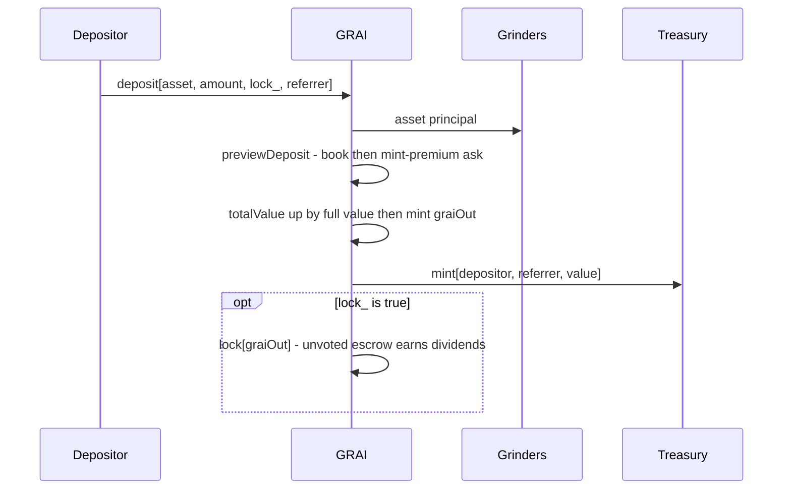
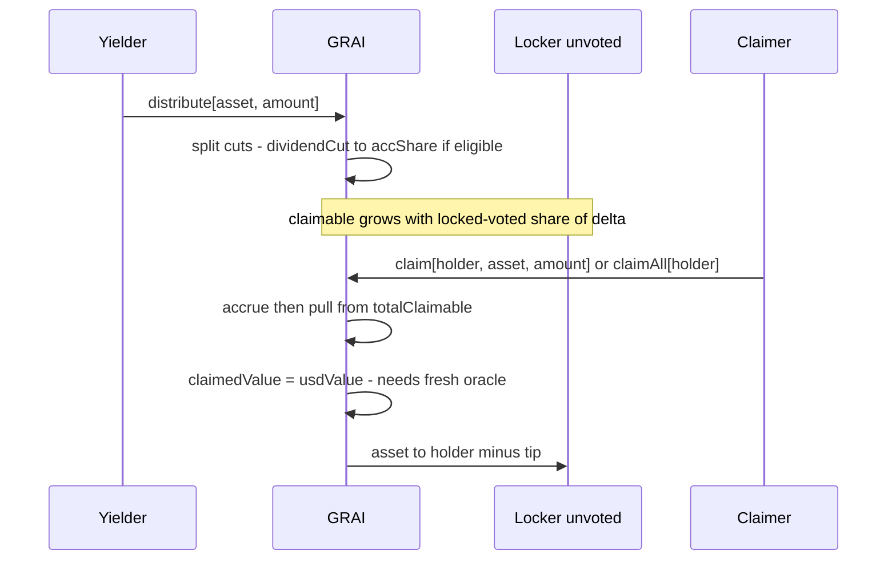
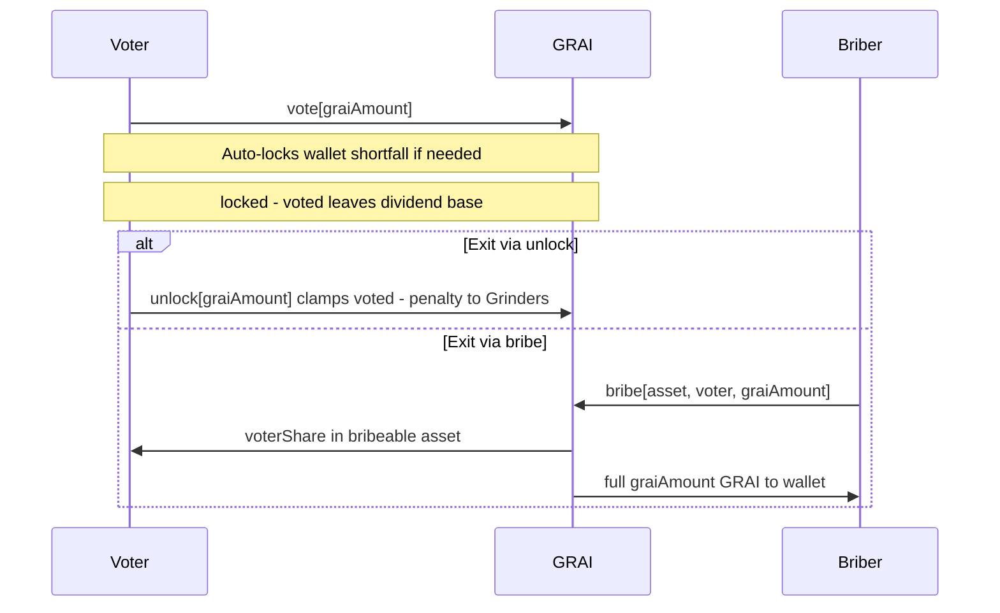
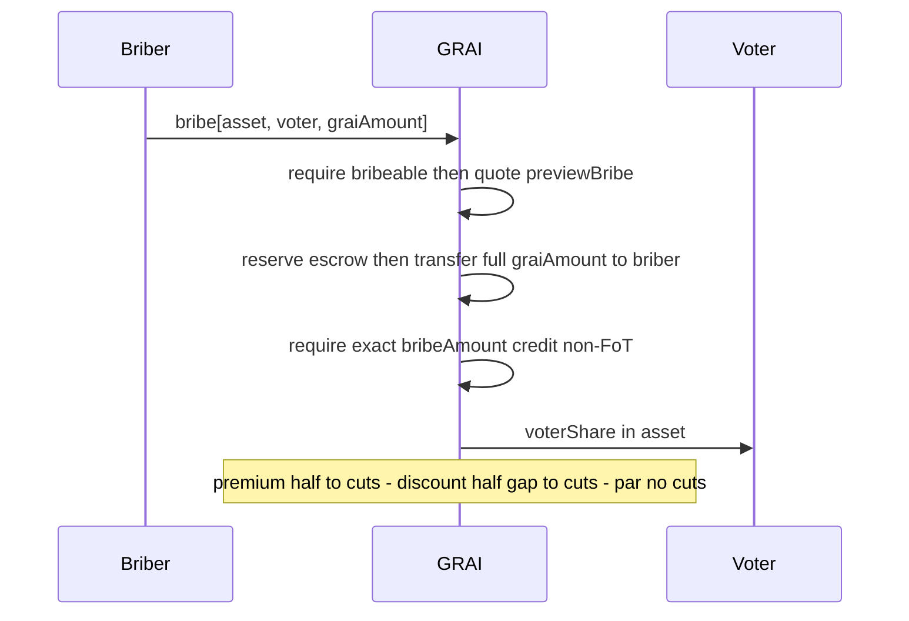
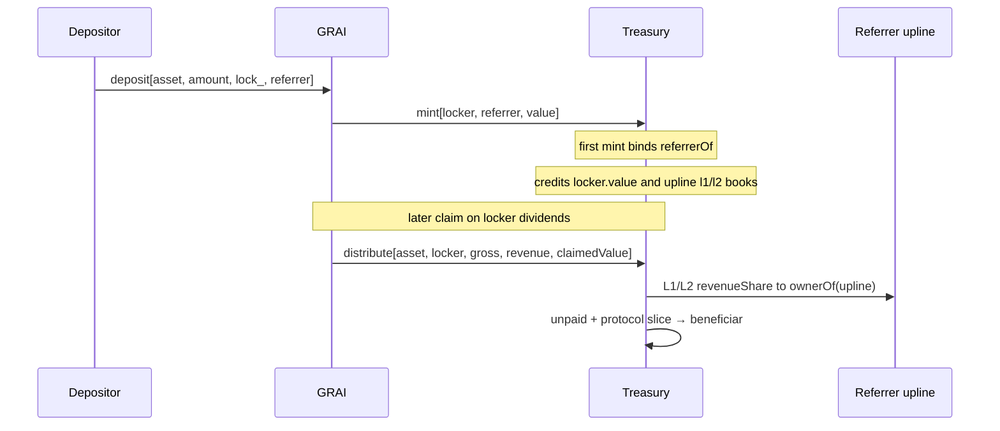

# GRAI Tokenomics — Protocol Overview

The key words **MUST**, **MUST NOT**, **REQUIRED**, **SHALL**, **SHALL NOT**, **SHOULD**, **SHOULD NOT**, **RECOMMENDED**, **NOT RECOMMENDED**, **MAY**, and **OPTIONAL** in this document are to be interpreted as described in [RFC 2119](https://www.rfc-editor.org/rfc/rfc2119) and [RFC 8174](https://www.rfc-editor.org/rfc/rfc8174).

Report derived from on-chain logic in [GRAI.sol](https://github.com/grindurus/grindurus-evm/blob/main/src/GRAI.sol), [IGRAI.sol](https://github.com/grindurus/grindurus-evm/blob/main/src/interfaces/IGRAI.sol), [Treasury.sol](https://github.com/grindurus/grindurus-evm/blob/main/src/Treasury.sol), and [Grinders.sol](https://github.com/grindurus/grindurus-evm/blob/main/src/Grinders.sol) (EVM implementation, October 2026). Integration happy path: [test/GRAILifecycle.t.sol](https://github.com/grindurus/grindurus-evm/blob/main/test/GRAILifecycle.t.sol). Mint premium: [test/GRAIMintPremium.t.sol](https://github.com/grindurus/grindurus-evm/blob/main/test/GRAIMintPremium.t.sol). Roles: [test/GRAIRoles.t.sol](https://github.com/grindurus/grindurus-evm/blob/main/test/GRAIRoles.t.sol). Affiliate / claim-time split: [test/TreasuryReferrals.t.sol](https://github.com/grindurus/grindurus-evm/blob/main/test/TreasuryReferrals.t.sol). Poach / tree book: [test/TreasuryPoach.t.sol](https://github.com/grindurus/grindurus-evm/blob/main/test/TreasuryPoach.t.sol).

---

## 1. Executive summary

**GRAI** (*Grinders Artificial Index*) is a USD-denominated fund-share ERC20 (6 decimals). Capital sits in **Grinders** and custodians.


Source: [protocol.svg](../protocol.svg) · PNG: [protocol.png](../protocol.png).

**Roles ladder**

```
holder  →  lock  →  locker (unvoted)  →  vote  →  voter  ←  bribe  ←  briber
                      earn dividends           no dividends on voted
                      (locked − voted)         quorum / bribe market
```

| Action | Who / what | Effect |
| ------ | ---------- | ------ |
| `deposit` | Anyone | Put in USDC/ETH/… → get GRAI. Can lock it and name a referrer in the same tx. |
| `lock` | Holder | Park GRAI in the protocol. While it sits locked **and** not voted, it earns yield. |
| `vote` | Holder (locks more GRAI if needed) | That GRAI stops earning. It counts toward liquidation quorum. |
| `distribute` | Anyone (usually via Grinders) | Yield arrives. By default half goes to earners, half to treasury. |
| `bribe(asset, …)` | Anyone | Pay a listed asset to buy someone’s **voted** GRAI. Price moves with how many votes there are. |
| `claim` | Anyone for a locker | Send the locker their earned yield assets. Also bumps referrer books (§9). |

**Core rules**

- Yield dividends go only to GRAI that is **locked and not voted**. Wallet GRAI and voted GRAI get no dividends.
- If you `vote`, you stop earning on that amount - but someone can buy your vote with `bribe`.
- If nobody is earning (everyone voted / nothing locked), that dividend goes to the **treasury** instead.
- Referrers do **not** take from your dividend payout. They get paid separately from the treasury when you `claim` (§9).

**How to exit** (while the fund is grinding there is **no** live redeem — you cannot burn GRAI for assets on demand):

1. **Sell free GRAI** — OTC / CEX / DEX. If GRAI is still locked, `unlock` first (flat fee, default 1% → Grinders).
2. `vote` **and** `bribe` — someone pays a `bribeable` asset for your **voted** GRAI. You get the asset; they get the GRAI. Price moves with how many votes there are (premium / par / discount).
3. **Liquidation redeem** — only when liquidation is open (needs vote quorum 2/3  **and** a stale Grinders heartbeat). After a delay you `redeem`: burn GRAI → get a share of the asset basket. Details: §8.

**Economic incentives**

| Participant               | Incentive                                                    |
| ------------------------- | ------------------------------------------------------------ |
| **Depositor**             | Mint GRAI at book (early depositors avoid the mint premium)  |
| **Locker**                | Earn asset dividends                                         |
| **Referrer (affiliate)**  | Share of treasury cut when downline claims                   |
| **Poacher**               | Own the upline seat → earn affiliate fees on claims          |
| **Voter**                 | Push toward liquidation; exit via bribe/unlock               |
| **Briber**                | Buy GRAI; reduce liquidation risk                            |
| **Grinders / toreador**   | Trade capital; send yield to protocol; keep the heartbeat alive |
| **Treasury / beneficiar** | Keep protocol / unpaid affiliate slice                       |

---

## 2. Oracle and protocol configuration

Every priced path reads `feeds[asset]`: **deposit**, **bribe**, **claim** (`claimedValue`), `previewDeposit`. No listed feed → no mint.

Owner lists with one call: `setFeed(asset, feed)`. Types: Chainlink, Pyth, or custom `(price, decimals, updatedAt)`. ETH = `address(0)`. **GRAI itself is never listed** (not in `assetList`; asset paths revert).

### 2.1 `setFeed`

| State now | Call does |
| --------- | --------- |
| Not listed | List (write feed + append `assetList`) |
| Listed, live | Change **pause** only |
| Listed, paused + live feed | Replace oracle (may unpause) |
| Listed, paused + `NONE` | Delist (blocked while liquidation open; need zero balance + `totalClaimable`) |

### 2.2 Pause vs stale

|                      | Blocks                                           | Does not block                         |
| -------------------- | ------------------------------------------------ | -------------------------------------- |
| `paused`             | `deposit` only                                   | `claim`, `distribute`, `bribe`, redeem |
| **Stale / bad feed** | Any path that **prices** (deposit, bribe, claim) | `distribute`, `redeem`, `revive`       |

**Replace feed without opening deposits:** pause → rewrite → unpause. **Delist:** pause → drain → claim leftovers → `setFeed(…, NONE)`.

Collateral is assumed non-rebasing. Bribe assets must also be non-FoT (§7).

### 2.3 Protocol defaults (`Config`)

| Parameter               | `ConfigId`           | Default         | Validation                         | Meaning                                                |
| ----------------------- | -------------------- | --------------- | ---------------------------------- | ------------------------------------------------------ |
| `dividendCutBps`        | — (initialize only)  | 50_00 (50%)     | `> 0`; sum with treasury = `BPS`   | → unvoted-locker dividends (or treasury if none)       |
| `treasuryCutBps`        | — (initialize only)  | 50_00 (50%)     | sum with dividend = `BPS`          | → treasury                                             |
| `revenueShareBps`       | `REVENUE_SHARE`      | 5_00 (5%)       | `≤ treasuryCutBps`                 | Of yield → affiliates on claim                         |
| `claimTipBps`           | `CLAIM_TIP`          | 1_00 (1%)       | `≤ 5%`                             | Slice of claimed dividend to `msg.sender`              |
| `bribePremiumBps`       | `BRIBE_PREMIUM`      | 2_00 (2%)       | `2 * value ≤ BPS`                  | Bribe ask slope vs half-quorum                         |
| `quorumBps`             | `QUORUM`             | 66_67 (66.67%)  | `2 ≤ value < BPS`                  | Strict: `voted/supply > quorumBps` (vote limb of open) |
| `unlockPenaltyBps`      | `UNLOCK_PENALTY`     | 1_00 (1%)       | `≤ 10%`                            | Flat unlock penalty (sent to Grinders)                 |
| `poachFeeBps`           | `POACH_FEE`          | 1_00 (1%)       | `≤ 10%`                            | `ceil` slice of poach ask → Grinders                   |
| `liquidationPeriod`     | `LIQUIDATION_PERIOD` | 24 hours        | `> 0`                              | Delay before `redeem`                                  |
| `redeemPeriod`          | `REDEEM_PERIOD`      | 7 days          | `> 0`                              | Window before `revive`                                 |
| `mintPremiumBpsPerYear` | `MINT_PREMIUM`       | 5_00 (5%/year)  | `≤ BPS`                            | Compound mint ask above book per full year             |
| `assets[asset].bribeable` | `BRIBEABLE`        | `false`         | asset listed, not GRAI             | Asset accepted by `bribe` / `previewBribe`             |

`setConfig(id, data)` is owner-only and **blocked entirely while liquidation is open**. Every patch re-runs `_requireValidConfig` (`BpsTooHigh` / `InvalidCuts` / `InvalidPeriod`). `BRIBEABLE` packs `data = uint160(asset) | (flag ? 1 << 160 : 0)` and writes `assets[asset].bribeable`, not a `Config` field. Treasury payout knobs (`setBeneficiar` / `setRoyaltyBps` / `setRevenueShareBps`) remain owner-mutable.

`dividendCutBps` / `treasuryCutBps` are set only at `initialize` and cannot be changed via `setConfig`. `mintPremiumAt` is set once at `initialize` (`0` disables the premium).

Grinders: `grindPeriod` default 7 days (owner `setGrindPeriod`, 1–30 days).

Treasury defaults: L1/L2 `revenueShareBps = [8000, 2000]` (fixed depth 2; `setRevenueShareBps` requires `length == 2` and `sum == BPS`), ERC-2981 `royaltyBps = 500`.

---

## 3. Actors and contracts

Cast list: who the actors are, and which contracts they touch. Playbooks below walk each role step by step.

| Name | Kind | What they do |
| ---- | ---- | ------------ |
| **Depositor / holder** | Actor | Puts assets in, gets GRAI. Can lock it and name a referrer in the same tx. |
| **Locker** | Actor | Keeps GRAI locked. Earns yield only on the part that is **not** voted. |
| **Voter** | Actor | Votes locked GRAI toward liquidation quorum. That part stops earning; someone can buy it with `bribe`. |
| **Briber** | Actor | Pays a listed asset to buy someone’s voted GRAI. |
| **Referrer (upline)** | Actor | Gets affiliate pay when a downline claims. Can sell that seat via `poach`. |
| **Poacher** | Actor | Buys someone’s upline seat for GRAI (tree moves; cashflow NFT does not). |
| **Owner** | Actor | Admin of GRAI (feeds, config, links, upgrades). Same address admins Grinders + Treasury. |
| **Toreador** | Actor | Ops on Grinders: move capital / push yield. Each call refreshes the liquidation heartbeat. |
| **GRAI** | Contract | Share token + locks, votes, bribes, dividends, liquidation. |
| **Grinders** | Contract | Holds the reserve, mints custodian NFTs, sweeps on liquidation. |
| **Custodian** | Contract | Per-NFT trading wallet. Yield goes back through Grinders → GRAI. |
| **Treasury** | Contract | Keeps treasury cut, referral tree, and cashflow NFTs. Pays affiliates on `claim`. |

Native ETH = `address(0)`. WETH is the fallback when ETH pushes are rejected.

`paused` on an asset gates `deposit` **only** (not distribute / claim / bribe) — oracle list / pause / delist is §2. GRAI is never in `assetList` (escrowed GRAI must not enter the redeem basket).

---

## Actor playbooks

### Depositor / locker



| Step | Action                                    | Effect                                                                                                                                           |
| ---- | ----------------------------------------- | ------------------------------------------------------------------------------------------------------------------------------------------------ |
| 0    | `previewDeposit(asset, amount)`           | Quote `(value, graiOut)` including mint premium                                                                                                  |
| 1    | `deposit(asset, amount, lock_, referrer)` | Asset → Grinders; mint at book / ask; referral bind on first deposit; optional escrow                                                            |
| 2    | Or later `lock(graiAmount)`               | Escrow wallet GRAI; dividend-eligible while unvoted (flat unlock fee — lock time does not change cost)                                           |
| 3    | Accrue / `claim(holder, asset, amount)`   | Receive yield-asset dividends (allowed in liquidation — reserve ≠ redeem basket)                                                                 |
| 4    | `unlock(graiAmount)`                      | Accrue, flat unlock fee → Grinders, clamp votes, return net                                                                                      |
| 5    | Optional `vote`                           | See Voter — voted share stops earning dividends                                                                                                  |

Examples 1–3 assume **year 0** of the mint-premium clock (or `mintPremiumBpsPerYear == 0`), so `graiOut = book`. After a full year the same deposits mint `book * BPS / priceBps` (e.g. ~95.24% of book at the default 5%/year) — see §5.1.

**Example 1** (happy path — default config, USDC @ $1, empty vault → mint at par):

Alice deposits **100 USDC** (`deposit(USDC, 100e6, true, address(0))`). Oracle marks them at $1 → `value = 100e6`. Empty vault (`totalValue == 0`) so mint is bootstrap:
`book = value` → she receives **100 GRAI**, which are escrowed unvoted; she is dividend-eligible on the full 100.
(When the book is live: `book = value * supply / totalValue`.)

**Example 2** (live book — same deposit into a non-empty vault, year 0):

- `totalValue = $1,234,567.80` (`1_234_567.8e6` book units)
- `supply = 1,000,000 GRAI` (`1_000_000e6`)
- Book price = `totalValue / supply ≈ $1.2345678` per GRAI

Alice again deposits **100 USDC** → `value = 100e6`:

```
graiOut = book = value * supply / totalValue
        = 100e6 * 1_000_000e6 / 1_234_567.8e6
        = 81_000_006   // integer division
        ≈ 81.000006 GRAI
```

She receives **≈81 GRAI** (not 100) because each share already marks above $1. Then `totalValue += 100e6`, `supply += graiOut`.

**Example 3** (deposit + lock — wallet vs escrow, dividend right):

Alice calls `deposit(USDC, 100e6, true, address(0))` on an empty vault (mint as in Example 1: **100 GRAI**):

| Where                      | Amount       | Notes                                                               |
| -------------------------- | ------------ | ------------------------------------------------------------------- |
| Alice wallet (`balanceOf`) | **0 GRAI**   | With `lock_ = true`, minted shares do not stay liquid               |
| Alice escrow (`locked`)    | **100 GRAI** | Minted via `book = value` (bootstrap); `voted = 0`                  |
| Dividend eligibility       | **100**      | `locked − voted` — unvoted lock earns asset yield from `distribute` |

She may later `claim` / `claimAll` yield assets accrued to that escrow.

---

### Claimer

Anyone may call `claim` / `claimAll` for a **holder** who has accrued yield on **unvoted** locked GRAI (`escrow.locked − escrow.voted`). Dividends are paid in the **yield asset** (not GRAI). **Allowed while liquidation is open**: `claim` pays only from the `totalClaimable` reserve, which `_redeemable` excludes from redeem / `revive` — the two pools do not mix. Unclaimed reserve also survives `revive`. (`unlock` itself is still blocked in liquidation.)

Claim needs a **live oracle** for the claimed asset: `claimedValue = usdValue(asset, claimed)` reverts on a stale feed. `paused` does not block claim; staleness can (and a stale asset inside `claimAll` reverts the whole call).

**Each successful** `claim` **also grows referral books:** Treasury credits `claimedValue` to the locker’s `value` and walks L1/L2 upline the same way as deposit `mint`. That permanently raises the locker (and upline) **poach ask** — claims compound seat price; `redeem` does not reverse them.



| Step | Action                         | Effect                                                                               |
| ---- | ------------------------------ | ------------------------------------------------------------------------------------ |
| 1    | Eligible lock                  | Unvoted escrow earns; liquid wallet GRAI and voted share earn **nothing**            |
| 2    | `distribute`                   | `dividendCut` raises `accShare` (or goes to treasury if no eligible locks / dust)    |
| 3    | Accrue                         | Holder debt sync; `previewClaim` / `previewClaimAll` for UI                          |
| 4    | `claim(holder, asset, amount)` | Pays up to `min(amount, claimable, balance, totalClaimable)` for one asset; anyone can call for `holder`; tip `claimTipBps` → caller; books += `usdValue(claimed)` |
| 5    | `claimAll(holder)`             | Same for every listed asset (each claim bumps books)                                 |
| 6    | Separate `claim` / `claimAll`  | Dividends are **not** pulled inside `unlock`                                         |

**Example** (happy path — Alice 100 locked unvoted, Bob 100 locked unvoted; `dividendCut` = 30 USDC; tip ignored):

1. Eligible base = 200. Alice’s share = 100/200 → **15 USDC** accrued; Bob → **15 USDC**.
2. Alice (or a keeper) calls `claim(alice, USDC, type(uint256).max)` → Alice receives **15 USDC**; her claimable for USDC → 0. Bob still has **15 USDC** unclaimed.
3. Alice `vote`s 40 of 100 → only **60** of hers stays in the index; Bob still **100**. Eligible base = **160**.
4. Second `distribute` with another **30 USDC** dividend cut:
   - Alice: 60/160 × 30 = **11.25 USDC** accrued
   - Bob: 100/160 × 30 = **18.75 USDC** accrued (on top of his leftover 15 → **33.75** claimable if he never claimed)
5. `claim(alice, …)` → Alice gets **11.25 USDC**. `claim(bob, …)` → Bob gets **15 + 18.75 = 33.75 USDC**

---

### Voter

Any holder may `vote` directly. If `voted + graiAmount > locked`, `vote` first `lock`s the shortfall, then commits. Voted GRAI is excluded from the dividend index.



| Step | Action             | Effect                                                                                                |
| ---- | ------------------ | ----------------------------------------------------------------------------------------------------- |
| 1    | `vote(graiAmount)` | Auto-lock shortfall; `voted ≤ locked`; `totalVoted` ↑; dividend base ↓                                |
| 2    | Quorum             | `totalVoted / supply > quorumBps` (strict) — necessary but not sufficient for open (also needs stale Grinders heartbeat) |
| 3a   | `unlock`           | Excess votes clamped; net GRAI returned; unlock fee sent to Grinders                                  |
| 3b   | `bribe`            | Full `graiAmount` sold for exact `bribeAmount` in a `bribeable` asset (non-FoT)                       |
| 3c   | `liquidate`        | Anyone: `regime == GRINDING` + `hasQuorum()` + `!grinders.grinding()`; flip `REDEMPTION` then `grinders.liquidate` |

**Example** (Alice votes — escrow and dividend base):

Supply = **1,000 GRAI**. Alice already has **100 GRAI** locked unvoted (`locked = 100`, `voted = 0`, wallet = 0).

1. Alice calls `vote(40)`.
2. No wallet shortfall (`voted + 40 ≤ locked`) → no extra `lock`.
3. After the call:

| Field                                   | Before | After  |
| --------------------------------------- | ------ | ------ |
| `escrow.locked`                         | 100    | 100    |
| `escrow.voted`                          | 0      | **40** |
| Dividend eligibility (`locked − voted`) | 100    | **60** |
| `totalVoted`                            | 0      | **40** |
| `totalVoted / supply`                   | 0%     | **4%** |

Her **40** voted GRAI no longer earn asset dividends and can be bought out via `bribe`. The remaining **60** stay in the dividend index. Quorum (~66.67%) is not met yet.

---

### Briber

Buys **voted** GRAI only (`graiAmount ≤ voted`). The payment `asset` must have `assets[asset].bribeable == true` (`NotBribeable` otherwise) and must **not** be fee-on-transfer: `_pay` must credit exactly `bribeAmount`, and the briber receives the **full** escrowed `graiAmount`.



| Step | Action                               | Effect                                                                                        |
| ---- | ------------------------------------ | --------------------------------------------------------------------------------------------- |
| 1    | `previewBribe(asset, voter, amount)` | Book (in `asset`) × (1 + dynamic adj); discount ask uses half gap                             |
| 2    | `bribe(asset, voter, amount)`        | Escrow reserved; full `graiAmount` → briber wallet; exact `_pay` required (`InvalidAmount` else) |
| 3    | GRAI out                             | Always the requested `graiAmount` (no FoT pro-rata / no leftover on voter)                    |
| 4    | Split                                | Premium: ½ premium → cuts; discount: other ½ gap → cuts; par: all to voter                    |
| —    | Self-bribe                           | **Allowed** (`briber == voter` is not reverted). Same ask / split as any bribe. At half-quorum (par: premium = discount = 0) settlement round-trips to self and full escrowed GRAI returns with **no** `unlockPenaltyBps` / dust floor — intentional: voted exit is the bribe market, not `unlock`. Off-par, self-bribe still pays the premium half-cut or takes the discount half-gap to cuts. |

To earn dividends after a bribe, the briber must `lock` the received GRAI (and leave it unvoted).

**Examples** (Brian bribes **Violett**’s **100 voted GRAI** in a bribeable asset worth $1; default config; `book = 100`; exact pay; Brian gets **100 GRAI**):

Setup: Violett locked and `vote`d **100 GRAI** (wallet = 0, escrow `locked = voted = 100`). She forgoes dividends on that share and waits for a briber. Brian buys her vote out.

| `totalVoted/supply` | Regime   | Brian pays | Violett (voter) receives | Cuts | Brian gets |
| ------------------- | -------- | ---------- | ------------------------ | ---- | ---------- |
| 15%                 | premium  | 101.09     | 100.55                   | 0.54 | 100 GRAI   |
| 60%                 | discount | 99.20      | 98.40                    | 0.80 | 100 GRAI   |
| 100%                | discount | 98.00      | 96.00                    | 2.00 | 100 GRAI   |

---

### Referrer (upline)

A **referrer** is whoever currently sits in `referrerOf(locker)` — the upline link set on a depositor’s **first** `mint`, later moved only by `poach` / `rebind`. That seat is **not** the cashflow NFT: claim pay at each upline level goes to `ownerOf(uint160(uplineLocker))`, which can be sold OTC without changing the tree (see §9).



| Step | Action                                     | Effect                                                                                        |
| ---- | ------------------------------------------ | --------------------------------------------------------------------------------------------- |
| 1    | First `deposit(asset, amount, lock_, referrer)` | Sets `referrerOf(locker)`; stub NFT to upline if needed; volumes into `value` / L1 / L2 books |
| 2    | Later deposits                             | Referrer arg ignored; books keep accruing on the live upline                                  |
| 3    | Locker `claim`                             | Affiliate pool sized from claimed dividends; walk the referral tree; pay **NFT owners**       |
| 4    | OTC transfer of NFT                        | Moves who receives that node’s claim slice; **does not** change `referrerOf` or books         |
| 5    | Someone `poach`es a downline               | Referrer is paid the ask minus `poachFeeBps` in GRAI and loses the upline seat (see Poacher)  |

Affiliates do **not** skim the locker’s dividend asset payout — they are paid from Treasury inventory on `claim`. Defaults and math: §9.

**Example** (Bob under Alice; Carol under Bob — tree vs cashflow):

1. Alice deposits with `referrer = 0` → self-root (`referrerOf(Alice) = Alice`), owns her cashflow NFT.
2. Bob deposits with `referrer = Alice` → `referrerOf(Bob) = Alice`; Alice’s `l1Value` ↑ by Bob’s book.
3. Carol deposits with `referrer = Bob` → Alice is L2 on Carol’s deposits (`l2Value` ↑).
4. On Carol’s `claim`, L1 pay goes to `ownerOf(Bob)`, L2 to `ownerOf(Alice)` — even if Alice sold her NFT to Eve OTC, Eve receives Alice’s L2 slice while `referrerOf(Bob)` stays Alice until someone poaches.

---

### Poacher

A **poacher** buys a bound locker’s **upline seat** for GRAI. Of the ask, `ceil(price * poachFeeBps / BPS)` (default 1%) goes to **Grinders**; the remainder goes to the **current** `referrerOf(locker)` (not necessarily the locker or the NFT owner). `rebind` rewrites the tree and shifts L1/L2 books; the cashflow NFT stays put. Blocked while liquidation is open. Full pricing / book shift: §10.

```mermaid
sequenceDiagram
    participant P as Poacher
    participant G as GRAI
    participant T as Treasury
    participant S as Seller referrer
    participant R as Grinders

    P->>G: previewPoach[locker, poacher] or poach[locker]
    G->>T: poachOf[locker, poacher]
    T-->>G: price, referrer
    G->>G: fee = ceil(price * poachFeeBps / BPS)
    G->>S: transfer price - fee GRAI from poacher
    G->>R: transfer fee GRAI from poacher
    G->>T: rebind[locker, poacher]
    Note over T: referrerOf[locker] = poacher
    Note over T: shift l1/l2 books; no NFT move
```

| Step | Action                          | Effect                                                                                      |
| ---- | ------------------------------- | ------------------------------------------------------------------------------------------- |
| 1    | `previewPoach(locker, poacher)` | Quotes full `price` + current referrer (seller); reverts if unbound, poacher already the referrer, `price == 0`, or poacher balance `< price` |
| 2    | Ask                             | `value + l1Value` — deposits **and** every prior claim’s `claimedValue` (**not** `l2Value`) |
| 3    | `poach(locker)`                 | Fee → Grinders, `price − fee` → seller in GRAI → `rebind(locker, poacher)`                  |
| 4    | After                           | Poacher is L1 on that locker; later deposits / claims follow the new tree (and further claims keep raising ask) |
| —    | Loop guard                      | Cannot poach an upline from a downline (`ReferralLoop`); first `mint` self-roots instead    |

**Example** (same tree: Alice ← Bob ← Carol; asks ignore deeper L2 cashflow; default `poachFeeBps = 1%`):

| Target         | Ask (GRAI)                          | Fee → Grinders | Paid to                         | After                                        |
| -------------- | ----------------------------------- | -------------- | ------------------------------- | -------------------------------------------- |
| `poach(Bob)`   | Bob.`value` + Bob.`l1Value` (Carol) | 1% of ask      | Alice (referrer of Bob), 99%    | `referrerOf(Bob) = poacher`; Alice loses Bob |
| `poach(Alice)` | Alice.`value` + Alice.`l1Value`     | 1% of ask      | Alice (self-root), 99%          | Poacher becomes L1 on Alice                  |

OTC sale of Alice’s NFT does **not** change who receives the next `poach(Bob)` payment — that still goes to `referrerOf(Bob)` until the tree is rebound.

---

## 4. Value flows (high level)

```
                    ┌──────────────────────────────────────────┐
                    │                   GRAI                   │
                    │  totalValue (book)                       │
                    │  locks + votes                           │
                    │  dividends (unvoted lockers only)        │
                    │  totalClaimable reserve (excluded from   │
                    │    redeem / revive basket)               │
                    │  poach — GRAI ask: fee → Grinders,       │
                    │    rest → referrer; rebind tree          │
                    └───┬───────────────┬──────────────┬───────┘
                        │               │              │
      principal, unlock │               │ claim        │ treasuryCut
      penalty, poach fee│               │ (affiliates) │ (yield / bribe)
                        ▼               ▼              ▼
                    ┌─────────┐   ┌────────────────────────────────┐
                    │Grinders │   │            Treasury            │
                    │reserve +│   │  referrer tree + cashflow NFTs │
                    │  NFTs + │   │                                │
                    │heartbeat│   │  on claim distribute:          │
                    └────┬────┘   │   revenueShare →               │
                         │        │     ownerOf(uint160(upline))   │
                         │        │   unpaid + protocol slice →    │
                         │        │     beneficiar                 │
                         │        └────────────────────────────────┘
                         │ allocate() (toreador)
                         ▼
                    ┌─────────┐
                    │Custodian│─── yield (Grinders.distribute) ──► GRAI.distribute
                    └─────────┘
```

`poach` moves GRAI wallet-to-wallet (buyer → current `referrerOf(locker)`, fee → Grinders); Treasury only rewrites the referrer link + L1/L2 books. Claim-time affiliate pay is separate: sized from claimed dividends, walked along uplines, paid to each upline’s **cashflow NFT owner**, remainder to `beneficiar` (§9–§10).

---

## 5. GRAI share mechanics

### 5.1 Deposit

You put in an asset (USDC, ETH, …) and get GRAI back.

Call: `deposit(asset, amount, lock_, referrer)`.

1. Protocol takes your asset and sends it to **Grinders**.
2. Oracle says how many USD that is (`value`).
3. Protocol mints you `graiOut` shares.
4. Optional: lock those shares and/or set a referrer in the same tx.

**How many GRAI do you get?**

- Empty fund (first depositors): **$1 of asset ≈ 1 GRAI**.
- Later: you get a fair share of the current book (`value × supply / totalValue`).
- After full years of mint premium (default **+5%/year**), you get **fewer** GRAI for the same USD — existing holders benefit. Year 0 = no premium. Details: [Deposit and mint](https://docs.grindurus.xyz/protocol/grai/deposit-and-mint).

```
value   = usd value of what you deposited
book    = empty fund ? value : value * supply / totalValue
graiOut = year 0 (or premium off) ? book : book / (1.05^years)   // default 5%/year
totalValue += value   // fund book always grows by the full USD, even if you mint fewer shares
```

Check the quote first with `previewDeposit`. No oracle / paused asset / liquidation open → deposit fails. Fee-on-transfer tokens are OK for deposit (protocol counts what actually arrived).

### 5.2 Book vs what you get in liquidation

| Idea | Meaning |
| ---- | ------- |
| **Book** | `totalValue / supply` — accounting price of one GRAI. Mint uses this (plus premium after year 0). |
| **Liquidation basket** | Real tokens sitting on GRAI for redeemers. **Not** the same as book. Unclaimed dividend reserve is kept out of this basket. |

Other simple facts:

- New deposits make liquidation quorum harder (more supply, same votes) until people vote again.
- `revive` after liquidation does **not** rewrite the book. If everyone already redeemed, book is already 0 and the next deposit starts fresh.

### 5.3 Kinds of GRAI you can hold

Think of three buckets for **your** GRAI:

| Kind | Where | Earns yield? | What it’s for |
| ---- | ----- | ------------ | ------------- |
| **Free** | Your wallet | No | Sell OTC/CEX/DEX; pay for `poach`; `lock` / `vote` |
| **Locked** | Parked in the protocol | Only the part you did **not** vote | Unlock (pay fee) or, if voted, get bought via `bribe` |
| **Unvoted** | = locked minus voted | **Yes** — this is the only slice that earns | `claim` yield; shrinks when you `vote` |

Moves:

- Wallet → locked: `lock` (or `vote` locks whatever you’re short).
- Locked → wallet: `unlock` (you pay a flat fee → Grinders) or `bribe` (buyer gets the GRAI in their wallet).
- Unvoted → voted: `vote`.
- Voted → unvoted: only if votes shrink (unlock clamp, or bribe takes them away).

**One-liners:** free GRAI in your wallet earns nothing. Fully voted lock earns nothing. Accidental GRAI stuck on the GRAI contract is not yours and does not earn until liquidation scoops it. Fee GRAI sitting on Grinders is just free GRAI there — also no dividends.

---

## 6. Yield: `distribute` → dividend / treasury

### 6.1 Cuts

```
received     = tokens pulled to GRAI
dividendCut  = received * dividendCutBps / BPS   // floor first
treasuryCut  = received - dividendCut            // remainder → treasury (claim asks stay ≤ inventory)
```

Initialize defaults: **50% dividend / 50% treasury** (must sum to `BPS`; `dividendCutBps > 0`). Yield cuts are fixed at `initialize` (not patchable via `setConfig`).

`GRAI.distribute(asset, yieldAmount)` is permissionless (GRINDING only; listed, non-GRAI asset). The custodian path is `Grinders.distribute(custodian, asset, amount)` (toreador only) → custodian → `GRAI.distribute`; only the Grinders path refreshes the liquidation heartbeat.

| Cut      | When unvoted locks exist                          | When `totalLocked == totalVoted` (or index dust) |
| -------- | ------------------------------------------------- | ------------------------------------------------ |
| Treasury | → `treasury`                                      | → `treasury`                                     |
| Dividend | → `assets[asset].accShare` + `totalClaimable`     | → `treasury`                                     |

Caller yield credited in `positions[from][asset].yielded` and `assets[asset].totalYielded` (analytics).

### 6.2 Locker dividends (unvoted only)

```
eligible     = totalLocked - totalVoted
accShare    += dividendCut * 1e18 / eligible     // or treasury if eligible == 0 / dust
totalClaimable += floor(eligible * accShare / 1e18) − previous  // delayed-whale increment
claimable   += (locked - voted) * accShare / 1e18 - debt
```

- Only **unvoted** locked GRAI earns asset dividends.
- Fully voted escrow (`locked == voted`) earns **none** on new cuts.
- New lockers sync debt to the **current** index → they do **not** receive past cuts.
- `vote` accrues then shrinks the eligible base and resyncs debt.
- Claim: `claim` / `claimAll` / previews — **allowed while liquidation is open** (pays only the reserved slice; does not touch the redeem basket). On claim, GRAI also asks Treasury to pay affiliates / `beneficiar` (see §9). Claim requires a fresh oracle for that asset (§2.2).
- Reserved `totalClaimable` is excluded from redeem / revive sweeps (`_redeemable = bal − totalClaimable`) and remains claimable during liquidation and after restart.

Example: Alice locks 100, votes 40 → unvoted 60. Bob locks 100 unvoted → unvoted 100. Total eligible 160. A 50 USDC dividend cut pays Alice **18.75**, Bob **31.25**.

---

## 7. Lock, vote, bribe

### 7.1 Lock / unlock

- `lock` — park GRAI. Only the **unvoted** part earns yield.
- `unlock` — flat fee (default **1%**, max 10%) → Grinders; rest back to your wallet. Fee does not depend on how long you locked. Claims are separate (`claim`).
- Min unlock size while fee > 0: `ceil(10000 / unlockPenaltyBps)` wei (100 wei at 1%). Smaller leftovers wait until you add more, fee is set to 0, or liquidation redeem.

### 7.2 Vote

- `vote` from wallet — auto-locks whatever you’re short. Voted GRAI stops earning and counts toward quorum.
- Quorum: `voted/supply` must be **strictly above** `quorumBps` (default ~66.67%). Exact equality is not enough.

### 7.3 Bribe

Someone pays a listed `bribeable` asset to buy **voted** GRAI. Owner flips `bribeable` via `setConfig(BRIBEABLE, …)` (new listings start `false`). Call: `bribe(asset, voter, graiAmount)`.

Rules:

- Asset must be non-FoT (exact pay in, full GRAI out). Stale oracle blocks that asset; `paused` does not.
- Blocked while liquidation is open.
- Self-bribe allowed — exit voted GRAI through the market with **no** unlock fee / dust floor.
- Briber gets full `graiAmount` to wallet. Voter’s escrow for that amount is closed.

**Price** moves with how many votes there are vs half-quorum (~33% at default). Few votes → briber pays a bit **above** book (premium; half of premium → cuts). Many votes → pays a bit **below** book (discount; half the gap → cuts). At half-quorum → par (voter gets everything).

```
book        = voted GRAI marked in the bribe asset
bribeAmount = book adjusted by vote share vs half-quorum
              (discount regime: only half the gap off the ask)
```

`previewBribe(asset, voter, graiAmount)` → `(bribeAmount, premium, discount)`.


| Votes / supply | Regime   | Briber pays (book=100) | Voter gets | Cuts |
| -------------- | -------- | ---------------------- | ---------- | ---- |
| 0%             | premium  | 102.00                 | 101.00     | 1.00 |
| 15%            | premium  | 101.09                 | 100.55     | 0.54 |
| ~33%           | par      | 100.00                 | 100.00     | 0    |
| 60%            | discount | 99.20                  | 98.40      | 0.80 |
| 100%           | discount | 98.00                  | 96.00      | 2.00 |

Cuts use the same 50/50 dividend / treasury split as `distribute`.

---

## 8. Liquidation cycle

Two regimes: `GRINDING` (normal) and `REDEMPTION` (liquidation open). `liquidation() = regime != GRINDING`. More detail: [Liquidation](https://docs.grindurus.xyz/protocol/grai/liquidation).

```
GRINDING ──quorum + stale Grinders──► REDEMPTION ──delay──► redeem window ──+redeemPeriod──► revive → GRINDING
```

### 8.1 Open (2-of-2)

Anyone calls `liquidate()` only if **both**:

1. **Vote quorum** — `voted/supply` strictly above `quorumBps` (~66.67%).
2. **Grinders stale** — `!grinding()`: no toreador `allocate` / `deallocate` / `distribute` (and no `revive` heartbeat) for `grindPeriod` (default **7d**, owner 1–30d). Plain `GRAI.distribute` does **not** refresh the heartbeat.

If both checks pass, opening does four things:

1. **(optional) Bonus to whoever opened** — any GRAI that accidentally sat on the GRAI contract (not locked by anyone) is given to the caller.
2. **Flip the regime** — regime becomes `REDEMPTION` and the clock starts (`liquidationAt`).
3. **Pull assets from Grinders and Custodians onto GRAI** — money sitting in custodian wallets / Grinders reserve is swept onto GRAI so holders, lockers and voters can redeem it.
4. **If that pull hard-fails** — the flip is undone. Fund stays in `GRINDING` like nothing happened.

While liquidation is open you **cannot** deposit, lock, unlock, vote, bribe, poach, or push new yield. You **can** still `claim` old dividends (that money is a separate pile from the redeem basket).

### 8.2 Redeem

Wait `liquidationPeriod` (default 24h). Then `redeem(graiAmount)`:

- Burn wallet + locked GRAI.
- Get your share of the **real token basket** on GRAI (pro-rata of supply). Unclaimed dividends stay out of that basket.
- Book (`totalValue`) shrinks with the burn. Referral books do **not** reverse.

### 8.3 Revive

After `liquidationPeriod + redeemPeriod`, anyone calls `revive()`:

- Leftover redeemable tokens → Grinders (dividend reserve stays on GRAI).
- Back to `GRINDING`; `grinders.heartbeat()` restarts the stale window.
- Book is **not** rewritten. Votes stay — but you cannot reopen until Grinders goes stale again.

### 8.4 Example

Setup before anyone opens liquidation:

| | |
| - | - |
| Supply | **1,000 GRAI** |
| Book (`totalValue`) | **$1,000** |
| Alice | **100 GRAI** free in wallet (10%) |
| Bob | **700 GRAI** locked + voted |
| Custodians / Grinders hold | **8,000 USDC** + **1 WETH** |
| Unclaimed dividends on GRAI | **50 USDC** (separate pile — not for redeem) |

1. Bob’s votes are above quorum (~70%). Grinders has been quiet for 7 days → `!grinding()`.
2. Carol calls `liquidate()`:
   - Regime → `REDEMPTION`, clock starts.
   - **8,000 USDC + 1 WETH** are swept onto GRAI.
   - Redeem basket = those assets. The **50 USDC** dividends stay reserved for `claim`.
3. After 24h Alice calls `redeem(100)`:
   - Burns her **100 GRAI** (supply → 900, book → $900).
   - Gets **10%** of the basket: **800 USDC + 0.1 WETH**.
4. Later Bob redeems his **700** → **5,600 USDC + 0.7 WETH**. Leftover basket for the last 200 GRAI: **1,600 USDC + 0.2 WETH**.
5. After the redeem window ends, anyone calls `revive()`:
   - Leftover redeemable tokens go back to Grinders.
   - The **50 USDC** dividend reserve (if still unclaimed) stays on GRAI.
   - Fund is `GRINDING` again; heartbeat restarts. Bob’s old votes are still there, but liquidation cannot reopen until Grinders goes stale again.

---

## 9. Treasury and affiliates

`[Treasury.sol](https://github.com/grindurus/grindurus-evm/blob/main/src/Treasury.sol)` is the fee sink for `treasuryCutBps` (yield / bribe carve-outs) and the referral layer. Affiliates do **not** cut the locker’s dividend payout — they are paid from Treasury inventory when the locker `claim`s. See also [Treasury and affiliates](https://docs.grindurus.xyz/protocol/grai/treasury-and-affiliates).

Three layers are kept separate:

| Layer             | Source of truth                                   | Changed by                                  |
| ----------------- | ------------------------------------------------- | ------------------------------------------- |
| **Slot**          | `tokenId = uint256(uint160(locker))`              | First `mint` (permanent locker id)          |
| **Tree (upline)** | `lockerBooks[locker].referrer` (= `referrerOf`)   | First `mint`; later only `rebind` / `poach` |
| **Cashflow**      | `ownerOf(tokenId)`                                | OTC `transfer` / `safeTransferFrom`         |

```
referrerOf(locker)            = lockerBooks[locker].referrer   // upline locker
ownerOf(uint160(locker))      = who receives that node’s claim pay
lockerBooks[locker].value     = Σ deposit + claimed-dividend book USD credited to locker
lockerBooks[node].l1Value     = Σ such credits for which node is L1 in the tree
lockerBooks[node].l2Value     = Σ such credits for which node is L2 in the tree
```

### 9.1 Binding (deposit → tree + cashflow NFT)

Every `deposit` calls `treasury.mint(locker, referrer, value)` (if Treasury reverts, deposit dies).

**First deposit** for a locker:

- One cashflow NFT forever: `tokenId = uint160(locker)`, minted to the locker.
- Upline = deposit `referrer`, or self if `0`. Bad/looping upline → self-root (§9.4). GRAI / Treasury / WETH as upline → revert.
- Stub NFT to a new upline if they have none yet (does not set *their* referrer).
- Any pre-bind books are mirrored onto the new upline so later `rebind` stays solvent.

**Later deposits:** referrer arg ignored. Each `value > 0` (and each claim’s `claimedValue`) credits locker `value` + up to L1/L2. Books are sticky — `redeem` does not undo them. Tree moves only via `poach` / `rebind` (§10); cashflow NFT trades OTC (§9.5). NFT royalties go to `beneficiar()`.

### 9.2 Claim-time split

Treasury cut lands on Treasury at `distribute`. Affiliates are paid later, on `claim`, from that inventory. Books (seat price) and NFT pay (`ownerOf`) stay separate.

```
claimedValue     = usdValue(asset, claimed)                 // bumps locker.value + L1/L2
grossProfitShare = claimed * treasuryCutBps  / dividendCutBps
revenueShare     = claimed * revenueShareBps / dividendCutBps   // ≤ treasury slice; default revenueShareBps = 5%
```

Why `/ dividendCutBps`: `claimed` is from the **dividend** slice, not raw yield. At 50/50, `grossProfitShare = claimed`.

From one yield `Y` (same idea for bribe carve-outs):

```
D = Y · dividendCutBps / BPS     // dividend cut
T = Y − D                        // treasury cut
R = Y · revenueShareBps / BPS    // affiliate budget
T / D = treasuryCutBps / dividendCutBps
R / D = revenueShareBps / dividendCutBps
claimed / D = grossProfitShare / T = revenueShare / R
```

Full claims conserve: `Σ grossProfitShare = T`, `Σ revenueShare = R`. Partial claims scale. Unpaid affiliate levels → `beneficiar` (`netProfitShare = grossProfitShare − paid`).

`treasury.distribute` then: credit books → if bal ≥ `grossProfitShare`, pay L1/L2 via `revenueShareInfo` (default **80/20**) to each `ownerOf(upline)` → rest to `beneficiar`. Soft-fail per payee. Same owner can get both levels if they hold both NFTs.

### 9.3 Affiliate examples

Default cuts **50 / 50** (dividend / treasury), illustrative `revenueShareBps = 1000` (10% of yield; ≤ `treasuryCutBps`), Treasury L1/L2 **80 / 20**. Yield **100 USDC** → dividend **50**, treasury inventory **50**. Sole locker claims all **50**:

```
grossProfitShare = 50 * 5000 / 5000 = 50
revenueShare     = 50 * 1000 / 5000 = 10    // L1 = 8, L2 = 2
```

Assume each upline still owns their own cashflow NFT (`ownerOf(node) == node`):

| Case                     | Tree (referrer)     | L1 payee  | L2 payee    | Beneficiar (`netProfitShare`) | Notes                                        |
| ------------------------ | ------------------- | --------- | ----------- | ----------------------------- | -------------------------------------------- |
| No referrer / self-root  | Alice → Alice       | 0         | 0           | **50**                        | Empty `revenueShareInfo`                     |
| L1 only                  | Alice → Bob         | **Bob 8** | 0           | **42**                        | Unpaid L2 (2) stays with protocol            |
| L1 + L2                  | Alice → Bob → Carol | **Bob 8** | **Carol 2** | **40**                        | Full affiliate pool paid                     |
| OTC moved L1 NFT         | Alice → Bob         | **Eve 8** | 0           | **42**                        | Tree still Bob; `ownerOf(Bob) = Eve`         |
| Half claim (25)          | Alice → Bob → Carol | **4**     | **1**       | **20**                        | Pro-rata (`gross = 25`, `revenue = 5`); rest of inventory waits |
| `bal < grossProfitShare` | any                 | 0         | 0           | 0                             | Distribute no-op; claim tip/locker still pay |

Locker still receives `claimed − tip` in full; tip (`claimTipBps`, default 1%) goes to `msg.sender`.

### 9.4 No referral loops

`rebind` / `poach` revert `ReferralLoop` if setting `locker.referrer = newReferrer` would cycle:

- Walk from `newReferrer` along referrers (tortoise/hare); revert if the path hits `locker`, returns to `newReferrer`, or finds any cycle in `newReferrer`’s upline.
- Deep **acyclic** trees are not treated as loops (no fixed hop cap false-positive).
- Self-root (`newReferrer == locker`) is allowed.
- Consequence: a **downline cannot poach an upline**.

First `mint` **does not revert** on a looping referrer: it binds **self-root** instead, so deposit still credits books.

`revenueShareInfo` / mint volume walks still stop on `ref == 0 || ref == locker || self-loop` as a safety cap.

### 9.5 OTC cashflow transfer

Ordinary ERC-721 `transferFrom` / `safeTransferFrom` moves **only** `ownerOf(tokenId)`:

- Does **not** change `referrerOf` or L1/L2 books.
- Does **not** brick later `poach` (tree and volumes stay consistent).
- Next claim that walks through that locker node pays the **new** NFT owner.

Poach and OTC are therefore two markets: tree seat vs cashflow receipt.

Tests: `[test/TreasuryReferrals.t.sol](https://github.com/grindurus/grindurus-evm/blob/main/test/TreasuryReferrals.t.sol)`, `[test/TreasuryPoach.t.sol](https://github.com/grindurus/grindurus-evm/blob/main/test/TreasuryPoach.t.sol)`.

---

## 10. Poach (buy the referrer link)

Anyone may buy a bound locker’s **upline seat** for **GRAI**. The full ask is paid by the poacher; a flat `poachFeeBps` slice goes to Grinders and the rest to the current `referrerOf(locker)`. This rewrites the referral tree; it does **not** move the cashflow NFT.

### 10.1 Interface

```
previewPoach(locker, poacher) → (price, referrer)   // view; full ask + current upline
poach(locker)                                       // msg.sender = poacher
```

`previewPoach` reverts if the locker is unbound (`ZeroAddress`), `poacher` is already the referrer (`AlreadyBound`), `price == 0`, or `balanceOf(poacher) < price` (`InvalidAmount`).

Flow:

1. `price, referrer = previewPoach(locker, poacher)` (wraps `treasury.poachOf(locker, poacher)`) — `referrer` is the upline, not `ownerOf`.
2. `fee = ceil(price * poachFeeBps / BPS)` → transfer `fee` GRAI from poacher → **Grinders**.
3. Transfer `price − fee` GRAI from poacher → `referrer`.
4. `treasury.rebind(locker, poacher)` — set `locker.referrer = poacher` + L1/L2 book shift (no NFT transfer).
5. Reverts `ReferralLoop` if the new link would cycle (§9.4).

### 10.2 Price

```
price        = lockerBooks[locker].value + lockerBooks[locker].l1Value
fee          = ceil(price * poachFeeBps / BPS)      // default 1% → Grinders
referrerNet  = price − fee
```

- `value` — locker’s own credited deposit + claimed-dividend book (poacher becomes **L1** on that locker’s future claims)
- `l1Value` — credits for which the locker is already L1 / direct recruits (poacher becomes **L2** on those claims)
- `l2Value` **is not in the ask** — deeper tree cashflow is not purchased by this poach

So the ask matches the two claim levels the buyer’s **tree position** receives under default Treasury L1/L2 depth, including realized dividend volume from `claim`. Who actually receives the USDC/ETH on claim is still `ownerOf` of each upline node (§9.2).

### 10.3 `rebind` book shift

On `rebind(locker, newReferrer)` with seller `from = referrerOf(locker)`:

| Who                                     | Update                                                 |
| --------------------------------------- | ------------------------------------------------------ |
| Referrer link                           | `lockerBooks[locker].referrer = newReferrer`           |
| Buyer `newReferrer` (if `≠ locker`)     | `l1Value += locker.value`, `l2Value += locker.l1Value` |
| Seller `from` (if `from ≠ locker`)      | same amounts subtracted                                |
| Old L2 `referrerOf(from)` (if distinct) | `l2Value -= locker.value`                              |
| New L2 `referrerOf(newReferrer)` (if distinct) | `l2Value += locker.value`                       |
| Cashflow NFT                            | **unchanged**                                          |

Self-slot sell (`from == locker`): seller keeps downline L1/L2 on the locker node; only the buyer (and optionally their upline as new L2) is credited.

Self-root reclaim (`newReferrer == locker`): debit the old upline only — do **not** credit `own` onto the locker’s `l1Value` (that would double-count in `poachOf = value + l1Value`).

`lockerBooks[locker].value` / `.l1Value` / `.l2Value` on the **locker key** are not zeroed — they still describe that depositor’s node. Upline books move as above so later asks stay consistent.

### 10.4 Worked example

Arrow = `referrerOf` (who sits above whom). Cashflow NFTs start owned by each node (`ownerOf(X) = X`).

**Setup** — deposits at $1 book; default `poachFeeBps = 1%`:

| Step | Action | After |
| ---- | ------ | ----- |
| 1 | Alice deposits **100**, `referrer = 0` | Alice roots on herself |
| 2 | Bob deposits **40**, `referrer = Alice` | Bob under Alice |
| 3 | Carol deposits **25**, `referrer = Bob` | Carol under Bob |

```
Before any poach:

        Alice (self-root)
          ↑
         Bob
          ↑
        Carol
```

| Node  | `value` | `l1Value`  | `l2Value`  | Poach ask | Fee → Grinders | Referrer nets |
| ----- | ------- | ---------- | ---------- | --------- | -------------- | ------------- |
| Alice | 100     | 40 (Bob)   | 25 (Carol) | **140**   | 1.40           | 138.60        |
| Bob   | 40      | 25 (Carol) | 0          | **65**    | 0.65           | 64.35         |
| Carol | 25      | 0          | 0          | **25**    | 0.25           | 24.75         |

On claim (tree → payee = NFT owner): Alice self; Bob → Alice; Carol → Bob → Alice.

#### A. Dias `poach(Alice)` — pays **140** (Alice nets **138.6**, Grinders **1.4**)

Alice’s self-root seat is sold. NFTs do **not** move.

```
Before:                         After:

    Alice (self)                    Dias
      ↑                               ↑
     Bob                           Alice
      ↑                               ↑
    Carol                            Bob
                                      ↑
                                    Carol
```

| Claimer | L1 | L2 |
| ------- | -- | -- |
| Alice   | **Dias** | — |
| Bob     | Alice | **Dias** |
| Carol   | Bob | Alice |

Dias paid for Alice+Bob volume (140), not Carol’s 25 (that is L3 from Dias).

#### B. Instead, Paul `poach(Bob)` — pays **65** (Alice nets **64.35**, Grinders **0.65**)

Only Bob’s upline link moves. Alice keeps Carol as L2? No — Alice loses Bob’s whole book (Bob + Carol weight). Paul becomes L1 on Bob and L2 on Carol.

```
Before:                         After:

    Alice                           Alice (alone)
      ↑                               ······
     Bob                            Paul
      ↑                               ↑
    Carol                            Bob
                                      ↑
                                    Carol
```

Ask `poach(Alice)` drops to **100** (Alice’s own value only).

#### C. Dias then Eve — resale path

```
Start:     Alice ← Bob ← Carol

1. Dias poach(Alice):

           Dias ← Alice ← Bob ← Carol

2. Eve poach(Bob):     Alice loses Bob; Dias loses L2-on-Bob

           Dias ← Alice
           Eve  ← Bob ← Carol

3. Eve poach(Alice):   Eve buys Alice from Dias (ask 100; Dias nets 99)

           Eve ← Alice
           Eve ← Bob ← Carol
             (Eve is L1 on both Alice and Bob)
```

#### D. OTC vs poach (tree unchanged)

Bob sells his cashflow NFT to Eve. **Tree stays the same**; only who receives Bob’s claim slice changes.

```
Tree (unchanged):     Alice ← Bob ← Carol

Cashflow:             ownerOf(Bob) = Eve   ← only this moved
```

- Carol’s claim still walks Bob → Alice on the tree, but L1 **pay** goes to Eve.
- `poach(Bob)` still pays **Alice** (current `referrerOf(Bob)`), not Eve.

### 10.5 Invariants (poach)

1. Ask = `value + l1Value` of the **locker**, never full deep subtree.
2. Payment always goes to **current referrer** (minus `ceil(price * poachFeeBps / BPS)` → Grinders), not necessarily the locker or the cashflow NFT owner.
3. Poach does **not** move any NFT; OTC does **not** rewrite `referrer` / books.
4. Later deposits keep accruing to the live upline (`mint` walk uses current `referrerOf`).
5. `previewPoach` / `poachOf` revert if unbound or `poacher` is already the referrer; `previewPoach` also reverts if `price == 0` or the poacher cannot pay.
6. `rebind` / `poach` revert `ReferralLoop` if the new upline link would cycle; first `mint` falls back to self-root instead.
7. `poach` reverts while liquidation is open (`LiquidationOpen`); same gate as deposit / lock / bribe.

Tests: `[test/TreasuryPoach.t.sol](https://github.com/grindurus/grindurus-evm/blob/main/test/TreasuryPoach.t.sol)`.

---

## 11. Grinders layer

Full write-up: [Grinders mechanics](https://docs.grindurus.xyz/protocol/grinders/mechanics).

Grinders has **no local Ownable**: `owner()` returns `grai.owner()` (or `address(grai)` if that call fails / returns zero). Day-to-day ops are gated to `toreador` only — the owner cannot substitute.

| Topic              | Behavior                                                                                   |
| ------------------ | ------------------------------------------------------------------------------------------ |
| Reserve            | Deposits, unlock penalties, poach fees, and `revive` leftovers land on Grinders           |
| `allocate`         | Toreador moves reserve to a registered custodian (heartbeat)                               |
| `deallocate`       | Toreador pulls custodian → Grinders reserve (heartbeat)                                    |
| `distribute`       | Toreador: custodian yield → `GRAI.distribute` (heartbeat)                                  |
| Custodian NFT      | Owner: `mint(label, nftOwner, baseAsset, quoteAsset)` / `register(custodian, nftOwner)`; `set(label, impl)`; `setAssets`; `upgradeCustodian` |
| Heartbeat          | `heartbeatAt` refreshed by `initialize`, the three toreador ops, and GRAI-only `heartbeat()` (on `revive`). `grinding() = now ≤ heartbeatAt + grindPeriod` |
| `grindPeriod`      | Default 7 days; owner `setGrindPeriod` (1–30 days)                                         |
| Liquidation sweeps | `liquidate(fromId, toId)` permissionless while `grai.liquidation()`; `fromId >= toId` sweeps idle listed balances |

---

## 12. Access control

Who is allowed to call what. Day-to-day user actions are permissionless; admin knobs sit on GRAI’s Ownable2Step owner. Grinders and Treasury do not have their own owners — they follow `grai.owner()`.

| Role                     | GRAI                                                                                                                                                                  |
| ------------------------ | --------------------------------------------------------------------------------------------------------------------------------------------------------------------- |
| **Owner** (Ownable2Step) | `setFeed` (list / pause / replace / delist), `setConfig` (incl. `BRIBEABLE`; not while liquidating), `setGrinders` / `setTreasury` (not while liquidating; target’s `grai()` must match), UUPS upgrade. `renounceOwnership` is disabled. Last-resort recipient if an ETH push and WETH wrap both fail |
| **Anyone**               | `deposit`, `lock` / `unlock` / `vote`, `distribute`, `claim` / `claimAll`, `bribe`, `poach`, `liquidate`, `redeem`, `revive`, all previews / views                    |

Grinders (no local Ownable; `owner()` = `grai.owner()`):

| Role         | Functions                                                                                      |
| ------------ | ---------------------------------------------------------------------------------------------- |
| **Owner**    | `setToreador`, `setGrindPeriod`, `set`, `mint`, `register`, `setAssets`, `upgradeCustodian`, UUPS |
| **Toreador** | `allocate`, `deallocate`, `distribute` (each refreshes the heartbeat)                          |
| **GRAI**     | `heartbeat` (called on `revive`)                                                               |
| **Anyone**   | `liquidate(fromId, toId)` while `grai.liquidation()`                                           |

Treasury: `mint` / `rebind` / `distribute` = linked GRAI only; `setBeneficiar` / `setRoyaltyBps` / `setRevenueShareBps` = `GRAI.owner()`; UUPS = `GRAI.owner()`.

---

## 13. Key invariants

Short checklist of rules the code is built around. If a new feature or a bugfix would break one of these, something is wrong. Not a tutorial — just the hard “always true” facts for reviewers and integrators.

1. **Book** — `totalValue` moves on deposit (full `value`) and redeem burn — not on yield or `revive`.
2. **Dividends = unvoted lock** — index uses `totalLocked − totalVoted`; account base is `locked − voted`.
3. **Past dividends are not diluted** — new locks sync debt to the live index.
4. **No unvoted locks → dividend cut to treasury** — same for the bribe carve-out dividend cut.
5. **Mint premium only reduces shares** — `graiOut = book * BPS / priceBps` after full years; `totalValue` always gains the full `value`.
6. **Quorum uses live supply** — deposits dilute progress until re-votes.
7. **Liquidation is 2-of-2 on open** — `hasQuorum()` **and** `!grinders.grinding()` in `GRAI.liquidate`. GRAI sets `REDEMPTION` before sweeps; `Grinders.liquidate` requires only `grai.liquidation()`. `revive` calls `grinders.heartbeat()`, so a fresh `grindPeriod` must elapse before reopening.
8. **Liquidation basket ≠ book** — pro-rata of redeemable GRAI balances after sweeps; `totalClaimable` reserved.
9. **Bribe / deposit / lock / unlock / vote / poach blocked in liquidation**; `claim` **/** `claimAll` **allowed** — dividend reserve and redeemable basket are separate (`_redeemable`).
10. **FoT** — deposit/`distribute` size economics from credited `_pay`; every `bribeable` asset is **non-FoT** (exact credit required; full `graiAmount` out).
11. `revive` does not touch `totalValue` (keeps ~$1/GRAI); after a full redeem the book is already 0, so the next deposit bootstraps.
12. `address(this)` **is never in** `assetList` — never redeemable, claimable, or bribeable; asset paths revert `AssetUnknown`.
13. **Unlock penalty → Grinders** — flat `unlockPenaltyBps` (no time decay); penalty GRAI is transferred to Grinders (not Treasury, not left dead on GRAI). Dust floor `ceil(BPS / unlockPenaltyBps)` applies to full-escrow exit; remainder below dust stays until lock grows, fee is 0, or liquidation redeem.
14. **Self-bribe allowed** — `briber == voter` is valid. Voted exit uses the bribe ask (incl. at-par round-trip with 0 premium/discount); `unlockPenaltyBps` / dust floor apply only to `unlock`, not to `bribe`.
15. **Affiliates ≠ locker cut** — claim tip / locker payout are independent of Treasury; affiliates pay from Treasury inventory sized by `revenueShareBps`.
16. **Treasury distribute is all-or-nothing** — `bal < grossProfitShare` → no affiliate / beneficiar transfer for that claim.
17. **Poach ask = locker** `value + l1Value` — deposits **and** every claim’s `claimedValue`; not `l2Value` / deeper tree. Fee `ceil(price * poachFeeBps / BPS)` → Grinders, rest → referrer. `rebind` shifts referrer + L1/L2 books (not the cashflow NFT); OTC moves `ownerOf` only. `redeem` does not shrink books.
18. **Each claim grows books** — `distribute(..., claimedValue)` credits `usdValue(asset, claimed)` before affiliate payouts; seat price compounds with realized dividends. Claim therefore needs a fresh oracle.
19. **No referral loops on poach** — `rebind` / `poach` revert `ReferralLoop` if the new upline would cycle; first `mint` self-roots instead. Claim walk still stops on `ref == locker` / self-loop.

---

## 14. Instruction reference

### GRAI

| Function                                       | Caller              | Liquidation open?                                                 |
| ---------------------------------------------- | ------------------- | ----------------------------------------------------------------- |
| `deposit(asset, amount, lock_, referrer)`      | Anyone              | Blocked                                                           |
| `lock` / `unlock` / `vote`                     | Anyone              | Blocked                                                           |
| `distribute(asset, yieldAmount)`               | Anyone (custodians via Grinders) | Blocked                                              |
| `claim(locker, asset, amount)` / `claimAll(locker)` | Anyone         | Allowed (claims ≠ redeem basket); needs fresh oracle              |
| `bribe(asset, voter, graiAmount)`              | Anyone              | Blocked; `asset` must be `bribeable`                              |
| `poach(locker)`                                | Anyone              | Blocked                                                           |
| `redeem(graiAmount)`                           | Holder              | Only when open (after delay); `nonReentrant`                      |
| `liquidate()`                                  | Anyone              | `GRINDING` + `hasQuorum()` + `!grinders.grinding()` → flip `REDEMPTION` then `grinders.liquidate`; orphan → opener |
| `revive()`                                     | Anyone              | After `liquidationPeriod + redeemPeriod`; `grinders.heartbeat()`; fund restarts |
| `setConfig(id, data)`                          | Owner               | Blocked while open                                                |
| `setFeed(asset, feed)`                         | Owner               | List / pause / replace oracle / delist (§2); delist blocked while open |
| `setGrinders` / `setTreasury`                  | Owner               | Blocked while open                                                |

**GRAI views**

| View                                              | Returns                                                       |
| ------------------------------------------------- | ------------------------------------------------------------- |
| `previewDeposit(asset, amount)`                   | `(value, graiOut)` incl. mint premium                         |
| `previewUnlock(account, graiAmount)`              | `(unlockAmount, penalty)`; reverts below dust                 |
| `previewClaim(locker, asset, amount)` / `previewClaimAll(locker)` | Pending dividends                             |
| `previewBribe(asset, voter, graiAmount)`          | `(bribeAmount, premium, discount)`                            |
| `previewPoach(locker, poacher)`                   | `(price, referrer)`                                           |
| `previewRedeem(holder, graiAmount)`               | Redeem vector (open + after delay)                            |
| `getRedeemables()`                                | Full basket in `assetList` order (open only)                  |
| `getAssets()` / `assets(asset)` / `feeds(asset)`  | Listed assets, per-asset state (`bribeable`, `accShare`, `totalClaimable`, `totalYielded`), oracle config |
| `getEscrows(voters_, fromId, toId)` / `escrows(account)` | Escrow rows (`locked`, `voted`, `votedAt`, …)          |
| `getLockersData(fromId, toId)`                    | Treasury locker rows + `previewClaimAll`                      |
| `hasQuorum()` / `regime()` / `liquidation()` / `liquidationAt()` | Liquidation state                              |
| `config()` / `mintPremiumAt()` / `totalValue()` / `totalLocked()` / `totalVoted()` | Parameters and totals        |
| `usdValue(asset, amount)` / `getPrice(asset)`     | Oracle marks                                                  |

### Treasury

| Function                                                 | Caller        | When                                                   |
| -------------------------------------------------------- | ------------- | ------------------------------------------------------ |
| `mint(locker, referrer, value)`                          | GRAI          | Every deposit (referrer tree + cashflow NFT to locker) |
| `getLockersData(fromId, toId)`                           | Anyone (view) | Paginate lockers + books (`tokenByIndex`)              |
| `referrerOf(locker)`                                     | Anyone (view) | Upline (`lockerBooks.referrer`)                        |
| `poachOf(locker, account)`                               | Anyone (view) | Poach ask + current referrer                           |
| `revenueShareInfo(locker, revenueShare)`                 | Anyone (view) | Claim-time payees (`ownerOf`) + shares                 |
| `rebind(locker, newReferrer)`                            | GRAI          | After `poach` (tree + L1/L2 books; no NFT transfer)    |
| `distribute(asset, locker, gross, revenue, claimedValue)` | GRAI         | On `claim`: books += claimed USD; payees = `ownerOf`   |
| `setBeneficiar` / `setRoyaltyBps` / `setRevenueShareBps` | GRAI owner    | Anytime                                                |

### Grinders

| Function                                                                 | Caller    | When                                  |
| ------------------------------------------------------------------------ | --------- | ------------------------------------- |
| `allocate` / `deallocate` / `distribute`                                 | Toreador  | Any time; refreshes heartbeat         |
| `mint` / `register` / `set` / `setAssets` / `upgradeCustodian`           | Owner (`grai.owner()`) | Any time                 |
| `setToreador` / `setGrindPeriod`                                         | Owner     | Any time (`grindPeriod` 1–30 days)    |
| `heartbeat`                                                              | GRAI      | On `revive`                           |
| `liquidate(fromId, toId)`                                                | Anyone    | `grai.liquidation()` only             |
| `grinding()` / `heartbeatAt()` / `grindPeriod()` / `getCustodiansData(fromId, toId)` | Anyone (view) | Liquidation-limb state, custodian pages |

---
