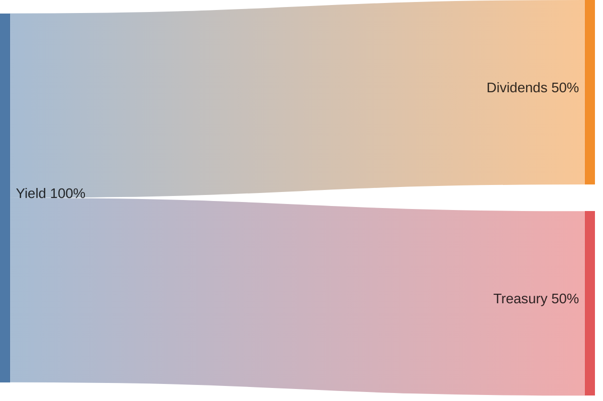

# GRAI overview

**GRAI** (*Grinders Artificial Index*) is the on-chain fund share — an ERC20 priced in USD (6 decimals).

You deposit listed assets, get GRAI, lock for yield or vote for shutdown, claim dividends, and exit via sell, bribe, or liquidation → redeem. Trading the basket is off-chain **Grinders**; this contract is the share ledger and cashflow harness. Economically it is an indexed perpetual delivery put with a live strike and a premium for volatility risk (§0). The rest of this page is how that works on-chain (§1–§9).

| Chain | Contract / program |
| ----- | ------------------- |
| EVM | `GRAI.sol` (UUPS) |
| Solana | `programs/grai` |

See [Protocol overview](../overview.md). Full math: [GRAI mechanics](mechanics.md).

---

## 0. Economic shape

Economically, GRAI is an **indexed perpetual delivery put option** with a **dynamically recalculated strike price** and earing a **premium** for bearing **volatility risk** with utilization of **listed assets**.

Each term word means:
| Term | What it means here |
| ---- | ------------------ |
| **Indexed** | Priced off a **USD book** of listed assets with price oracles|
| **Perpetual** | **No expiry.** Runs while grinding; exit is sell, bribe, or liquidate. |
| **Delivery put option** | Use GRAI for redeem the **listed assets**. |
| **Strike price** | The **estimated price of the real assets** — what they should sell for. |
| **Premium** | earn yield for bearing **volatility risk**. |

The sections below are the know-how for making that economic shape real (mint, lock, yield, exit).

---

## 1. Deposit and mint

You send a listed asset (ETH, USDC, …). The contract prices it with an oracle and mints GRAI. Your asset goes into the Grinders reserve. GRAI is your receipt that you put money in. No listed price feed → no mint. GRAI itself is never collateral.

```
You ──asset──► GRAI ──mint shares──► You (wallet / lock)
                 │
                 └── asset ──► Grinders reserve (bots trade later)
```

After year 0 the mint ask rises (~5%/year by default). Book value still grows by the full USD of the deposit, but you get fewer shares. Early holders are not diluted 1:1. Year 0 is 1:1.

```
$100 deposit, year 0  → +$100 book, ~100 GRAI
$100 deposit, year 1  → +$100 book, ~95 GRAI  (same money in, fewer shares out)
```

On the same call you can lock the new GRAI and bind a referrer once.

---

## 2. Lock and unlock

`lock` parks GRAI in escrow. `unlock` returns it to your wallet minus a flat fee (default **1%**) to Grinders. Free GRAI in a wallet earns nothing and does not vote. Locked GRAI can earn dividends (if not voted) or count toward liquidation (if voted). The fee makes unlock slightly sticky.

```
Wallet GRAI ──lock──► Escrow (locked)
                           │
              ┌────────────┴────────────┐
              │ unvoted → can earn      │ voted → quorum only
              └────────────┬────────────┘
                           │
Wallet ◄──unlock (−1%)─────┘
              │
              └── fee GRAI ──► Grinders
```

| Your GRAI | Dividends? | Votes for liquidation? |
| --------- | ---------- | ---------------------- |
| In wallet (free) | No | No |
| Locked, not voted | **Yes** | No |
| Locked + voted | No | **Yes** |

---

## 3. Distribute

When Grinders push profit, anyone calls `distribute`. Yield splits 50/50 by default: half indexed for lockers, half to Treasury. Only locked, unvoted GRAI shares the dividend cut. If nobody is eligible (or the cut is dust), that half goes to Treasury too. Distribute does not send assets to wallets — it only records who is owed what.



---

## 4. Claim

Eligible lockers `claim` / `claimAll` listed assets accrued from distribute. Anyone may call claim for a locker. Claims still work in liquidation — the dividend reserve is not the redeem basket. On claim, Treasury may also pay affiliates from its inventory. Needs a fresh oracle for that asset.

```
accShare on GRAI ──claim(asset)──► assets to locker
                                      │
                                      └── Treasury pays L1/L2 / beneficiar
                                          (from Treasury inventory, not from claim)
```

---

## 5. Vote

`vote` marks locked GRAI as “I want liquidation on the table.” Missing amount is auto-locked from your wallet. Voted GRAI leaves the dividend pool. Votes need more than ~⅔ of supply. You pay with yield so shutdown is not free. New deposits grow supply and dilute progress.

```
Supply ████████████████████████  100%
Voted  ████████████████░░░░░░░░  need > ~66.7%
              ▲
         your vote adds here
         and removes you from dividends
```

---

## 6. Bribe

`bribe` lets anyone buy voted GRAI from a voter with a listed `bribeable` asset. The buyer gets full GRAI in wallet. Blocked while liquidation is open. Self-bribe is allowed if you want out of votes without the unlock fee. Price goes up when votes are scarce and down when the quorum pile is already huge. Bribes peel votes without waiting for unlock.

```
Voter (voted GRAI) ◄──bribe(asset)── Briber
        │                                │
        │ GRAI → briber wallet           │ asset → protocol path
        ▼                                ▼
   fewer votes toward liquidation
```

---

## 7. Treasury and affiliates

Treasury holds the treasury cut of yield. When someone claims, it pays affiliates from its own inventory — not from the locker's dividend asset. Referral growth and the protocol fee sink live here, not inside the share token. Each locker gets an NFT slot. The **tree** (who is L1/L2) is separate from **cashflow** (who owns the NFT and gets paid).

```
Yield 100%
 ├── Dividends 50% ──────────────► lockers (claim)
 └── Treasury 50%
      ├── Affiliates ~5% ──► L1 (4%) + L2 (1%) on claim
      └── Beneficiar ~45% ─► protocol remainder
```

On first deposit you can set a referrer. Selling the NFT moves who gets paid. `poach` moves who sits in the tree.

---

## 8. Poach

`poach(locker)` buys that locker's upline seat for GRAI. A small fee (default 1%) goes to Grinders. The rest pays the current referrer. Then the tree rebinds. Blocked in liquidation. No referral loops. Poach moves the tree; selling the NFT moves cashflow.

```
Before:  Referrer A ──tree──► Locker
After poach:
         Poacher ──tree──► Locker     (A paid in GRAI, minus fee)
         NFT owner still owns cashflow until they sell the NFT
```

---

## 9. Liquidation (open → redeem → revive)

There is no live redeem while the fund trades. Liquidation is the orderly exit. `liquidate` needs vote quorum **and** a stale Grinders heartbeat. Both keys: voters cannot nuke a live operation, and silent ops cannot stall forever without votes. After a delay, holders `redeem` (burn GRAI → share of assets). Later `revive` restarts grinding.

```
GRINDING
   │  needs: vote quorum  AND  !grinders.grinding()
   ▼
REDEMPTION ──wait liquidationPeriod──► redeem (burn → assets)
   │
   └── after + redeemPeriod ──► revive ──► GRINDING again
```

| Regime | Meaning |
| ------ | ------- |
| **GRINDING** | Normal fund life |
| **REDEMPTION** | Shutdown open; redeem window |

Unclaimed dividends stay on GRAI through revive. `revive` does not rewrite book price from leftover NAV.

---

## Read next

- [GRAI mechanics](mechanics.md) — same sections, expanded (formulas, examples, EVM entrypoints)
- [Protocol overview](../overview.md) — GRAI vs Grinders
