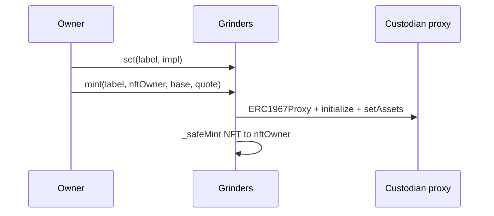
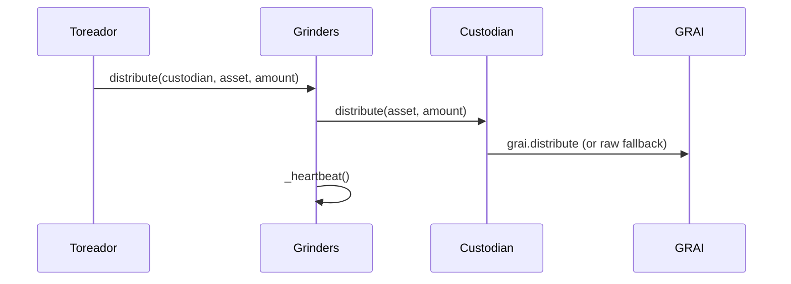
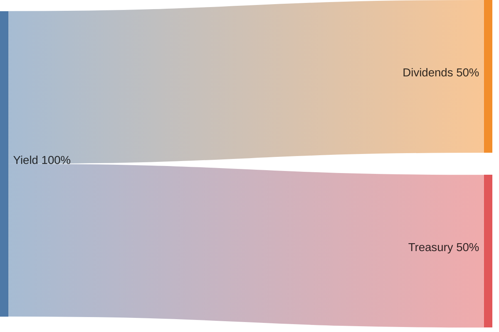

# Grinders mechanics

Expanded write-up of [Grinders overview](overview.md). Same section order and topics; here: diagrams, formulas, worked examples, and the **EVM entrypoints** each mechanic maps to.

The key words **MUST**, **MUST NOT**, **REQUIRED**, **SHALL**, **SHALL NOT**, **SHOULD**, **SHOULD NOT**, **RECOMMENDED**, **NOT RECOMMENDED**, **MAY**, and **OPTIONAL** are as in [RFC 2119](https://www.rfc-editor.org/rfc/rfc2119) / [RFC 8174](https://www.rfc-editor.org/rfc/rfc8174).

Derived from [Grinders.sol](https://github.com/grindurus/grindurus-evm/blob/main/src/Grinders.sol), [Custodian.sol](https://github.com/grindurus/grindurus-evm/blob/main/src/Custodian.sol), and kinds under [`src/custodians/`](https://github.com/grindurus/grindurus-evm/blob/main/src/custodians) (EVM, October 2026). GRAI share / dividend / liquidation open: [GRAI mechanics](../grai/mechanics.md). Strategy layer: [Strategy](strategy.md).

Map: [protocol.svg](../protocol.svg) · [protocol.png](../protocol.png). Access, invariants, and ABI tables live in [§A–§C](#a-access-control).

---

## 0. Executive summary

**Grinders** is the junior-capital vault and custodian registry. Reserve holds deposits; each **GRINDERS** NFT is a trading wallet; toreador moves capital and reports yield; NFT owner trades. Strategy decisions live **off-chain**.

```
deposit → reserve → allocate → custodian trade → distribute(yield) → GRAI
                         ▲                            │
                         └── deallocate (principal) ──┘
```

| § | Mechanic | One-liner | Primary EVM |
| - | -------- | --------- | ----------- |
| [1](#1-reserve) | Reserve | Idle capital + fee GRAI on Grinders | (receives from GRAI) |
| [2](#2-mint-and-register) | Mint and register | Kind impl → proxy + NFT | `set` / `mint` / `register` |
| [3](#3-allocate) | Allocate | Reserve → custodian; heartbeat | `allocate` |
| [4](#4-trade) | Trade | NFT owner kind API | custodian `swap` / CoW / … |
| [5](#5-distribute) | Distribute | Custodian yield → GRAI; heartbeat | `distribute` |
| [6](#6-deallocate) | Deallocate | Custodian → reserve; heartbeat | `deallocate` |
| [7](#7-heartbeat) | Heartbeat | Stale limb of GRAI liquidation | `grinding` / `heartbeat` |
| [8](#8-liquidation-sweeps) | Liquidation sweeps | Page wallets / idle reserve → GRAI | `liquidate` |

**Core rules**

- GRAI book does **not** move on trades — only on deposit / redeem / revive; yield enters via `GRAI.distribute`.
- No on-chain allocate ledger — use `Allocate` / `Deallocate` events.
- Day-to-day capital moves = **toreador**; registry / mint = **owner** (`grai.owner()`); trades = **NFT owner**.
- GRAI opens liquidation only with vote quorum **and** `!grinders.grinding()`.

### Economic incentives

| Participant | Incentive |
| ----------- | --------- |
| **Protocol owner** | Register kinds, mint custodians, set toreador / `grindPeriod` |
| **Toreador** | Allocate / deallocate / distribute; keep heartbeat alive; report yield |
| **NFT owner (Grinder)** | Trade allocated inventory; grow wallet balances |
| **GRAI lockers** | Receive dividend cut when toreador distributes yield |
| **Treasury / beneficiar** | Treasury cut of distributed yield |
| **Liquidation keepers** | Page `liquidate` after GRAI opens REDEMPTION |
| **Depositors** | Capital sits in reserve / custodians until redeem |

---

## 1. Reserve

Deposits from `GRAI.deposit` land on Grinders. Idle assets earn nothing until allocated. Unlock / poach fees arrive as **GRAI ERC20** on Grinders — free inventory, not yield, not part of allocate accounting.

### EVM

| Contract | Function | Role |
| -------- | -------- | ---- |
| `GRAI` | `deposit` / `unlock` / `poach` / `revive` | Push assets or GRAI / leftovers onto Grinders |
| `Grinders` | `balance(asset)` / `receive()` | Reserve inventory views / ETH |

### Flow

```
Users ──deposit──► GRAI ──assets──► Grinders reserve
Users ──unlock──► GRAI ──penalty GRAI──► Grinders (free GRAI)
revive leftovers ──────────────────────► Grinders reserve
```

GRAI `totalValue` is independent of how the reserve is later split across custodians.

---

## 2. Mint and register

Owner registers implementations by kind label, then deploys or attaches custodian proxies and mints the NFT.

### EVM

| Contract | Function | Role |
| -------- | -------- | ---- |
| `Grinders` | `set(label, implementation)` | Register kind; `impl.label()` must match |
| `Grinders` | `mint(label, nftOwner, base, quote)` | Deploy ERC1967 proxy + NFT + `setAssets` |
| `Grinders` | `register(custodian, nftOwner)` | Attach pre-deployed proxy; mint NFT |
| `Grinders` | `setAssets(custodian, base, quote)` | Retarget pair (balances of pair must allow) |
| `Grinders` | `upgradeCustodian(custodian)` | UUPS to current `set` impl for its label |
| `Custodian` | `initialize(grinders)` / `label()` | Proxy init; kind id |

Default NFT owner if `address(0)`: **toreador**. Collection: **Grinders Custodians** / `GRINDERS`.

### Flow



### Labels (EVM kinds)

Registered under kind-specific `label()` (family `grinder.custodian.<name>@eip155:<chainid>` → `keccak256`):

| Kind | Contract | How it trades |
| ---- | -------- | ------------- |
| path | `PathCustodian` | Router calldata + price limit |
| swap | `SwapCustodian` | Swap helper |
| cow | `CoWCustodian` | CoW EIP-1271 orders |
| lifi | `LiFiCustodian` | LiFi routing |
| aave_v3 | `AaveV3Custodian` | Aave V3 |

Views: `getCustodiansData(fromId, toId)`, `custodianIdOf`, `labelOf`, `isCustodian`, `tokenURI`.

---

## 3. Allocate

Toreador moves reserve into a registered custodian. Refreshes heartbeat. Requires `balance(asset) ≥ amount`.

### EVM

| Contract | Function | Role |
| -------- | -------- | ---- |
| `Grinders` | `allocate(custodian, asset, amount)` | Toreador; ETH or ERC20 transfer; emit `Allocate` |

### Flow

```
Grinders reserve ──allocate──► Custodian
                     │
                     ├── emit Allocate(custodian, asset, amount)
                     └── _heartbeat()
```

### Off-chain issuance

```
event Allocate(address indexed custodian, address indexed asset, uint256 amount);
event Deallocate(address indexed custodian, address indexed asset, uint256 amount);

net_issuance(custodian, asset) ≈ Σ Allocate − Σ Deallocate
```

No `allocated` storage. After swaps, returned token/size need not match what was sent.

### Example

Reserve holds **100,000 USDC**. Toreador `allocate(custodian, USDC, 50_000)` → wallet has 50k; reserve 50k; heartbeat refreshed.

---

## 4. Trade

NFT owner (`Custodian.owner()` = `Grinders.ownerOf(id)`) runs kind-specific trading. Balances stay on the wallet until distribute / deallocate / liquidation.

### EVM

| Contract | Function | Role |
| -------- | -------- | ---- |
| `PathCustodian` / `SwapCustodian` / … | kind trade APIs | NFT owner only |
| `Custodian` | `nav()` | USD mark of base+quote via GRAI oracles (ops / UI) |
| `Custodian` | `baseAsset` / `quoteAsset` | Trading pair |

Blocked implicitly when liquidation is open for money-out paths (`deallocate` / `distribute` revert `LiquidationOpen`). Trading should be treated as frozen once GRAI is in REDEMPTION.

### Flow

```
NFT owner ──trade──► Custodian balances change
                         │
                         └── still on wallet until report / pull
```

### Example

Allocate **50,000 USDC** to a path custodian (`base=WETH`, `quote=USDC`). Operator swaps over time; wallet ends with **52,000 USDC**. Profit is still just a higher balance until `distribute`.

---

## 5. Distribute

Toreador reports yield from a custodian into GRAI. Refreshes heartbeat. Intentionally **not** capped by prior allocates.

### EVM

| Contract | Function | Role |
| -------- | -------- | ---- |
| `Grinders` | `distribute(custodian, asset, yieldAmount)` | Toreador → `Custodian.distribute` → heartbeat |
| `Custodian` | `distribute(asset, yieldAmount)` | Grinders-only; try `GRAI.distribute`; fallback raw send |
| `GRAI` | `distribute(asset, yieldAmount)` | Split dividend / treasury cuts |

Blocked on custodian while `grai.liquidation()`. Plain `GRAI.distribute` (not via Grinders) does **not** refresh heartbeat.

### Flow





Defaults **50% / 50%**. Full cut rules: [GRAI mechanics — Distribute](../grai/mechanics.md#3-distribute).

### Formulas (GRAI side)

```
received     = tokens credited to GRAI
dividendCut  = received × dividendCutBps / BPS
treasuryCut  = received − dividendCut
```

Analytics: `positions[custodian][asset].yielded` on GRAI.

### Example

Wallet has **52,000 USDC** after trades from a 50k allocate. Toreador `distribute(custodian, USDC, 2_000)` → GRAI splits ~1,000 dividends / ~1,000 treasury. Remaining **50,000** can later `deallocate`.

---

## 6. Deallocate

Toreador pulls inventory back to the reserve. Not capped by prior allocates. Heartbeat refreshed. Blocked while GRAI liquidation is open.

### EVM

| Contract | Function | Role |
| -------- | -------- | ---- |
| `Grinders` | `deallocate(custodian, asset, amount)` | Toreador; emit `Deallocate`; heartbeat |
| `Custodian` | `deallocate(asset, amount)` | Grinders-only; send to Grinders |

### Flow

```
Custodian ──deallocate──► Grinders reserve
                │
                ├── emit Deallocate
                └── _heartbeat()
```

### Example

After distribute of 2k profit, toreador `deallocate(custodian, USDC, 50_000)` refills reserve. If the wallet holds WETH instead, deallocate that asset — net by `(custodian, asset)` is informational only.

---

## 7. Heartbeat

Implicit “ops are alive” flag. GRAI’s liquidation open needs quorum **and** `!grinding()`.

### EVM

| Contract | Function | Role |
| -------- | -------- | ---- |
| `Grinders` | `grinding()` | `now ≤ heartbeatAt + grindPeriod` |
| `Grinders` | `heartbeatAt` / `grindPeriod` | State / window (default **7d**, owner 1–30d) |
| `Grinders` | `setGrindPeriod(uint32)` | Owner |
| `Grinders` | `heartbeat()` | GRAI-only (on `revive`) |
| `Grinders` | `allocate` / `deallocate` / `distribute` | Each calls `_heartbeat()` |

### Formulas

```
heartbeatAt  ← now   on allocate / deallocate / distribute / heartbeat()
grinding()   = block.timestamp ≤ heartbeatAt + grindPeriod
```

```
GRINDING ops     ──activity──► heartbeatAt refreshed
after grindPeriod with no ops ──► !grinding()
GRAI.liquidate needs hasQuorum() AND !grinding()
GRAI.revive ──► grinders.heartbeat() ──► fresh window
```

Keepers’ `Grinders.liquidate` does **not** check `grinding` — only that GRAI liquidation is already open.

---

## 8. Liquidation sweeps

After `GRAI.liquidate` flips **REDEMPTION**, anyone pages Grinders to pull capital onto GRAI for redeem.

### EVM

| Contract | Function | Role |
| -------- | -------- | ---- |
| `GRAI` | `liquidate()` | 2-of-2 open; nested sweeps |
| `Grinders` | `liquidate(fromId, toId)` | Anyone while `grai.liquidation()` |
| `Custodian` | `liquidate()` | Grinders-only; sweep ETH / base / quote → Grinders |
| `Grinders` | `liquidation()` | Forwards `grai.liquidation()` |

### Flow

```
GRAI open (quorum + !grinding)
        │
        ▼
Grinders.liquidate(fromId, toId)
        ├── fromId < toId → for each id: Custodian.liquidate → forward to GRAI
        └── fromId ≥ toId → sentinel: sweep Grinders balances of grai.getAssets() → GRAI
```

Per-custodian `try/catch` keeps earlier pulls if one wallet reverts. While open: custodian `distribute` / `deallocate` revert. Holders redeem on GRAI; `revive` returns leftovers and calls `heartbeat()`.

Full GRAI cycle: [GRAI mechanics — Liquidation](../grai/mechanics.md#9-liquidation-open--redeem--revive).

### Example

GRAI open. Keeper `liquidate(0, 50)` pages first 50 custodians. Later `liquidate(max, max)` (or any `fromId >= toId`) sweeps idle USDC/WETH still on Grinders onto GRAI.

---

## A. Access control

Grinders has **no local Ownable**: `owner()` returns `grai.owner()` (or `address(grai)` if that call fails / returns zero). Day-to-day capital ops are **toreador-only** — owner cannot substitute.

| Role | Powers |
| ---- | ------ |
| **Owner** (`grai.owner()`) | `setToreador`, `setGrindPeriod`, `set`, `mint`, `register`, `setAssets`, `upgradeCustodian`, UUPS |
| **Toreador** | `allocate`, `deallocate`, `distribute` (each refreshes heartbeat) |
| **NFT owner** | Custodian trade APIs |
| **GRAI** | `heartbeat` (on revive) |
| **Anyone** | `liquidate(fromId, toId)` while `grai.liquidation()` |

Wire-up: `GRAI.setGrinders(grinders)` requires `grinders.grai() == GRAI`.

---

## B. Key invariants

1. **Reserve ≠ strategy** — earnings happen in custodians (and off-chain), not by sitting idle.
2. **Yield is explicit** — profit enters GRAI only via `distribute`, not balance drift.
3. **No allocate ledger** — use events; do not expect on-chain caps.
4. **Trust model** — NFT owners trade; toreador moves capital and reports yield. Mis-`distribute` of principal is governance/monitoring, not an on-chain profit check.
5. **Heartbeat limb** — GRAI open needs `!grinding()`; sweeps after open do not re-check it.
6. **Listed assets** — idle sweeps follow `grai.getAssets()`; custodian pull is ETH + base + quote.
7. **Non-rebasing** listed collateral assumed (same as GRAI).
8. **Fee GRAI on Grinders** — unlock/poach fees are free GRAI inventory, not yield.

---

## C. Instruction reference

### Grinders

| Function | Caller | Notes |
| -------- | ------ | ----- |
| `set` / `mint` / `register` / `setAssets` / `upgradeCustodian` | Owner | Registry lifecycle |
| `setToreador` / `setGrindPeriod` | Owner | Ops role; window 1–30d |
| `allocate` / `deallocate` / `distribute` | Toreador | Heartbeat; deallocate/distribute blocked on custodian if GRAI liquidating |
| `liquidate(fromId, toId)` | Anyone | While `grai.liquidation()`; page vs idle sentinel |
| `heartbeat` | GRAI | On revive |
| `grinding` / `heartbeatAt` / `grindPeriod` / `getCustodiansData` / `liquidation` | Anyone (view) | State |

### Custodian

| Function | Caller | Notes |
| -------- | ------ | ----- |
| Trade APIs | NFT owner | Kind-specific |
| `setAssets` / `deallocate` / `distribute` / `liquidate` | Grinders | Money paths |
| `nav` / `baseAsset` / `quoteAsset` / `label` | Anyone (view) | Ops / UI |

---

## Read next

- [Grinders overview](overview.md) — short plain-language map
- [Strategy](strategy.md) — grind, store, swap; adapters
- [GRAI mechanics](../grai/mechanics.md) — shares, distribute cuts, liquidation open
- [Protocol overview](../overview.md) — module split
